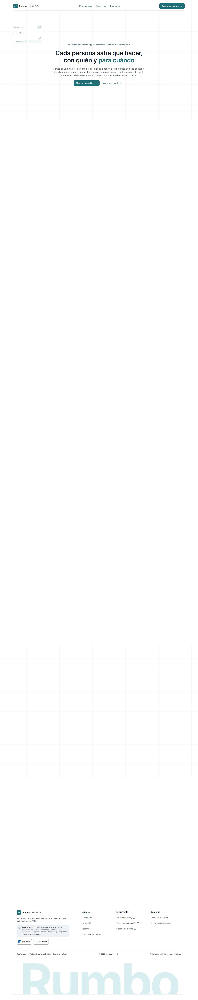
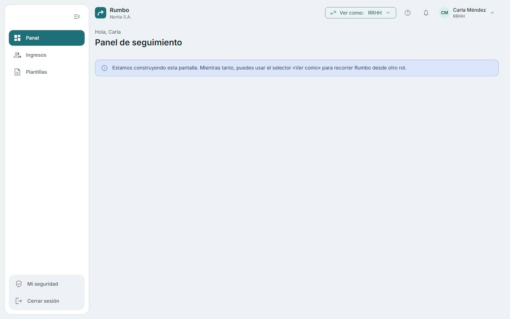
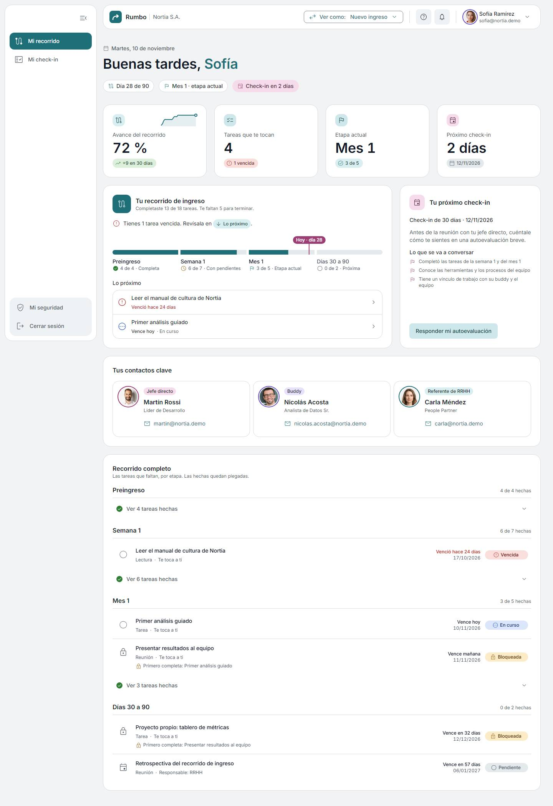
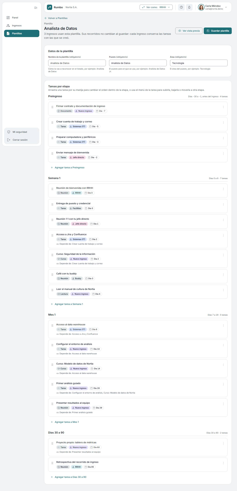
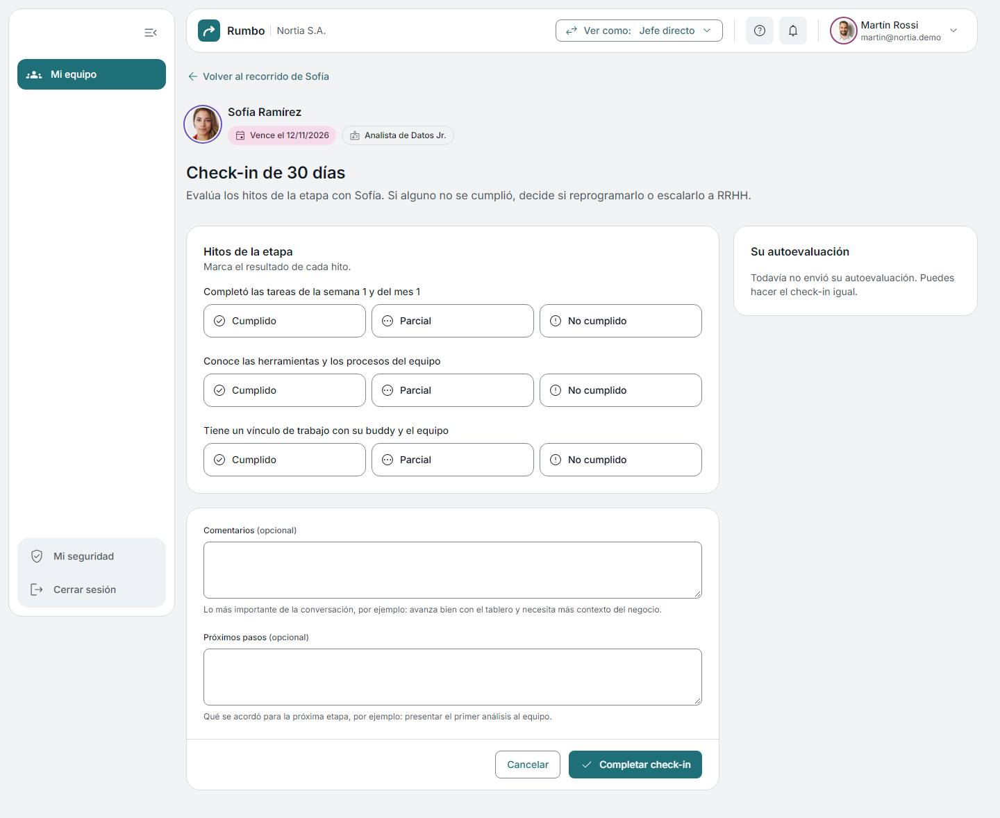
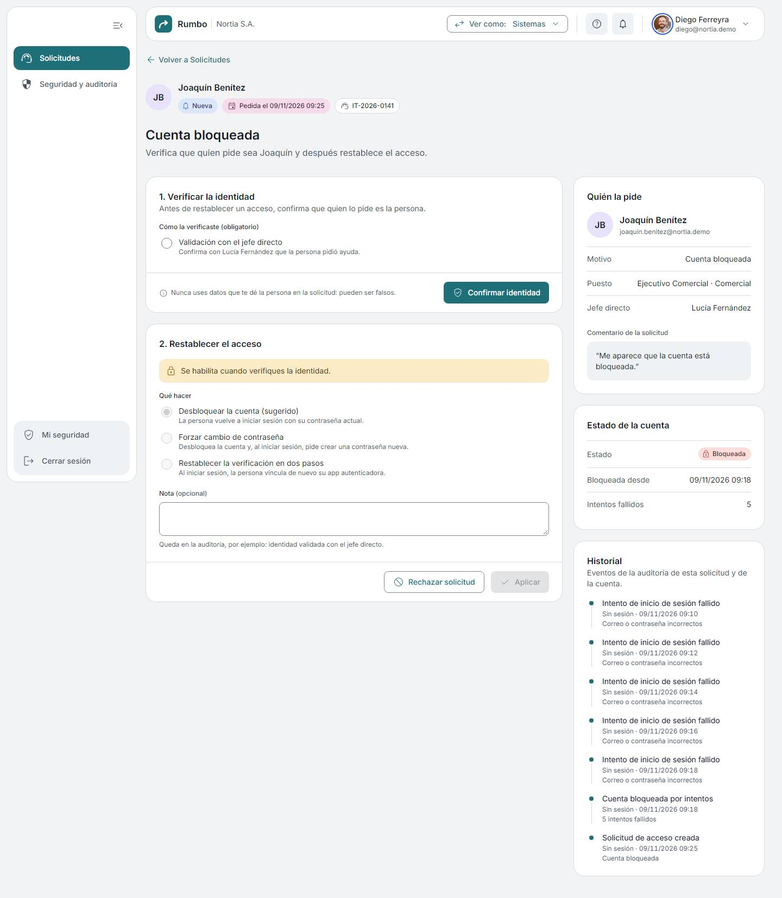
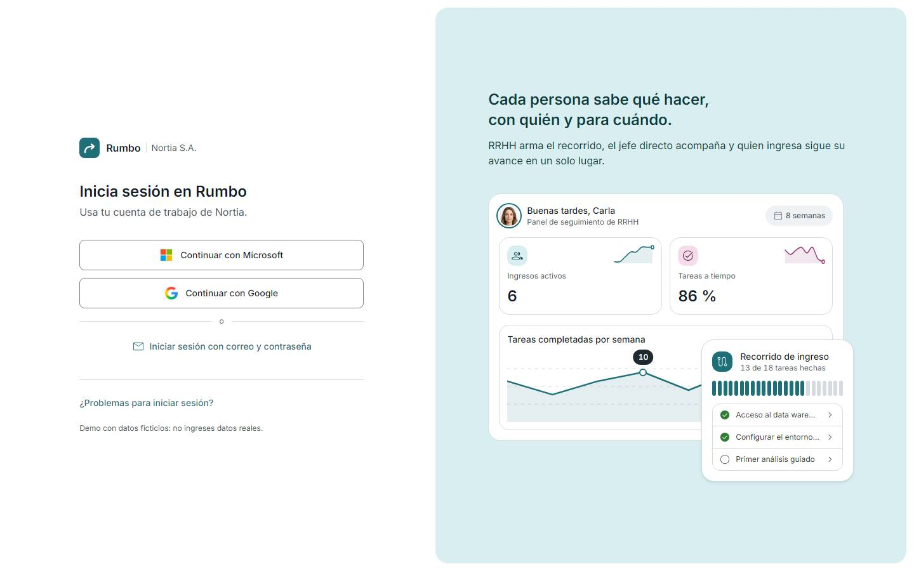
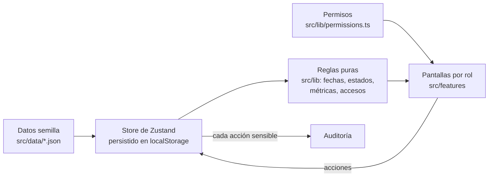

<div align="center">


# Rumbo

**Cada persona sabe qué hacer, con quién y para cuándo.**

Plataforma B2B de onboarding corporativo · Caso de diseño UX/UI y prototipo navegable de alta fidelidad

[**Ver la demo**](https://lpedaci.github.io/rumbo-app/) · [Case study](https://lpedaci.github.io/portfolio/) · [Documentación](docs/README.md) · [Sistema de diseño](docs/design-system.md)




</div>

---

## El problema

En muchas empresas, el ingreso de una persona nueva depende de planillas, correos sueltos y de la memoria de quien la recibe. El resultado se repite:

- **La persona nueva** no sabe qué tiene que hacer primero, con quién hablar ni para cuándo.
- **El jefe directo** se entera tarde de que algo se trabó y llega al check-in sin datos.
- **RRHH** arma el mismo recorrido una y otra vez y no ve dónde se atrasan los ingresos.
- **Sistemas** recibe pedidos de acceso urgentes, sin contexto y sin forma segura de verificar quién los pide.

## La solución

Rumbo convierte el ingreso en un **recorrido por etapas** (preingreso, semana 1, mes 1, días 30 a 90) que RRHH diseña una vez por puesto y que se adapta a cada fecha de ingreso. Cada tarea tiene responsable, plazo y dependencias; el jefe acompaña con **check-ins 30/60/90**; y RRHH ve en un panel **dónde se traban los recorridos** para actuar a tiempo.

---

## Un recorrido para cada rol

La demo se recorre con cuatro personas ficticias de **Nortia S.A.** y se puede cambiar de rol en cualquier momento con el selector **Ver como**.

| | Rol | Qué hace | Pantallas principales |
| --- | --- | --- | --- |
|  | **Carla Méndez** · RRHH | Diseña plantillas por puesto, da de alta ingresos y sigue el avance y las alertas | Panel (A1), ingresos (A2 a A4), plantillas (A5 a A7) |
|  | **Martín Rossi** · Jefe directo | Acompaña a su equipo, hace los check-ins y escala a RRHH si un hito no se cumple | Mi equipo (J1), ficha (J2), check-in (J3) |
|  | **Sofía Ramírez** · Nuevo ingreso | Ve su recorrido, completa tareas y responde su autoevaluación | Mi recorrido (N1), tarea (N2), autoevaluación (N3) |
|  | **Diego Ferreyra** · Sistemas | Atiende solicitudes de acceso verificando la identidad, revisa la auditoría y las políticas | Solicitudes (S1, S2), seguridad y auditoría (S3) |

<table>
  <tr>
    <td width="50%"><br /><sub><b>A1 · Panel de seguimiento.</b> KPIs, avance por cohorte o por persona, alertas priorizadas y dónde se traban los recorridos.</sub></td>
    <td width="50%"><br /><sub><b>N1 · Mi recorrido.</b> Línea de tiempo por etapas, lo próximo y contactos clave.</sub></td>
  </tr>
  <tr>
    <td><br /><sub><b>A6 · Constructor de plantillas.</b> Arrastrar y soltar con alternativa por teclado, dependencias y validación de ciclos.</sub></td>
    <td><br /><sub><b>J3 · Check-in 30/60/90.</b> Hitos con resultado, autoevaluación del ingreso y escalamiento a RRHH.</sub></td>
  </tr>
  <tr>
    <td><br /><sub><b>S2 · Solicitud de acceso.</b> Primero se verifica la identidad; recién después se restablece el acceso.</sub></td>
    <td><br /><sub><b>G1 · Inicio de sesión.</b> SSO, MFA y bloqueo por intentos, simulados y rotulados como simulación.</sub></td>
  </tr>
</table>

---

## Proceso de diseño


1. **Proto-personas** por rol, rotuladas como hipótesis sin validar, con su tabla de supuestos y un plan de validación ([personas](docs/personas.md)).
2. **Arquitectura de la información** con sus cuatro sistemas (organización, rotulado, navegación y búsqueda) y el mapa del sitio por rol ([IA](docs/information-architecture.md)).
3. **Requerimientos** funcionales y no funcionales medibles, priorizados con MoSCoW y una matriz de decisión ([requerimientos](docs/requirements.md)), y **casos de uso** ([casos de uso](docs/use-cases.md)).
4. **Task flows, user flows y wireflows**, cada uno rotulado por tipo, y diagramas de estados ([flujos](docs/flows.md)).
5. **Auditoría visual** contra las referencias y un piloto rediseñado antes de escalar el estilo ([auditoría](docs/visual-audit.md)).
6. **Iteración con registro**: cada decisión de diseño queda en [`docs/decisions.md`](docs/decisions.md) con la duda, lo decidido y por qué; cada problema, en [`docs/issues.md`](docs/issues.md).

El recorrido aplica **diseño instruccional** a un proceso de negocio: etapas con objetivos claros, tareas encadenadas por dependencias, hitos evaluables en los check-ins y retroalimentación visible del avance.

---

## Sistema de diseño


Material Design 3 traducido a tokens propios: no se ve como una app de Google, pero hereda su rigor.

- **Color por roles de M3:** petróleo (`primary`), petróleo apagado (`secondary`) y ciruela como complementario (`tertiary`), más colores de estado y un color por rol de persona. Contraste AA verificado por test.
- **Tipografía:** Inter con la escala de M3 y los títulos enfatizados de M3 Expressive; cifras tabulares en KPIs, tablas y fechas.
- **Jerarquía por elevación tonal**, no por sombras; sin degradés; una sola forma de esquinas suaves en botones, pestañas y chips.
- **Bento** para paneles, **línea de tiempo** del recorrido, **encabezado de ficha** único, tablas que se seleccionan por fila completa y pie de formulario anclado.
- **Movimiento** con las curvas de M3, 150 a 300 ms, escalonado al entrar y siempre respetando "reducir animaciones".

Todo está documentado con sus valores reales en [`docs/design-system.md`](docs/design-system.md) y visible en la página interna `/styleguide` (solo en desarrollo).

---

## Accesibilidad


Integrada desde el diseño, no como revisión al final:

- Etiqueta visible y **texto de ayuda con formato y ejemplo** en cada campo; errores que no aparecen mientras se escribe, desaparecen al corregir y nunca borran lo cargado.
- Navegación completa con teclado, foco siempre visible y nunca tapado, enlace "Saltar al contenido" y modales con foco atrapado.
- **Arrastrar y soltar con alternativa** (subir, bajar, mover a etapa) en el constructor de plantillas.
- Gráficos con título, resumen en texto y tabla para lectores de pantalla; estados siempre con ícono y texto, nunca solo color.
- Código de verificación en un solo campo que acepta pegar (WCAG 3.3.8) y aviso de sesión por vencer con opción de extenderla (2.2.1).

---

## Seguridad en tres capas

1. **Simulada en la interfaz:** SSO, MFA, bloqueo por intentos, derivación obligatoria a sistemas con **verificación de identidad**, expiración de sesión, permisos por rol y auditoría.
2. **Aplicada de verdad:** Content Security Policy en el sitio publicado, validación de formularios con esquemas de Zod, sin HTML construido con datos, `npm audit` en CI y dependencias con versión fija.
3. **Arquitectura de producción:** OIDC/SAML con Entra ID o Google Workspace, SCIM, sesiones con cookies `HttpOnly`, autorización en el servidor y por fila, auditoría inmutable, Ley 25.326 y GDPR.

Detalle completo, amenazas y mitigaciones en [`docs/security.md`](docs/security.md).

---

## Cómo está armado


Es un **prototipo funcional sin backend**: las pantallas responden de verdad (crear, editar, completar, aprobar) y los cambios se guardan en el navegador.



*Los datos semilla cargan el store; las pantallas leen a través de reglas puras (fechas, estados, métricas) y de una única matriz de permisos; cada acción vuelve al store y, si es sensible, deja un evento de auditoría.*

- **Una sola fuente de permisos:** rutas y botones consultan `can(user, acción)`; la matriz que ve sistemas en S3 se genera desde el mismo archivo.
- **Reglas de negocio puras y probadas:** fechas (`dueDate = ingreso + plazo`), estados calculados (bloqueada, vencida), métricas del panel y atribución de atrasos a quien bloquea.
- **Fecha fija de demo** (`10/11/2026`) para que los datos siempre se vean coherentes.
- **Sin textos en los componentes:** todo vive en `src/locales/` (español latinoamericano neutro con tuteo, e inglés).

```
src/
  app/          rutas, layout y enlaces
  components/   ui/ (botones, campos, tablas, KPIs, bento) y layout/ (barra, navegación, encabezados)
  features/     una carpeta por área: home, auth, journey, templates, hires, dashboard, team, checkins, it
  lib/          reglas puras: fechas, recorrido, métricas, permisos, accesos, validación
  store/        stores de Zustand (datos, sesión, interfaz)
  data/         datos semilla en JSON
  locales/      es.json y en.json
  styles/       tokens de Material 3 y utilidades
docs/           documentación del proyecto (ver docs/README.md)
e2e/            pruebas de desbordes y accesibilidad con Playwright
```

---

## Calidad


- **Tests unitarios y de componentes** (Vitest y Testing Library): reglas de negocio, permisos, contraste de tokens y flujos de cada rol.
- **Desbordes en 6 anchos** (320, 375, 768, 1024, 1280 y 1440 px) con capturas en [`docs/screenshots/`](docs/screenshots/) y **axe** en cada pantalla (Playwright).
- **CI en cada push:** auditoría de dependencias, lint, tests, build, control de la CSP y deploy a GitHub Pages.

---

## Correrlo localmente

Requiere Node.js 22 o superior.

```bash
npm install
npm run dev
```

| Comando | Para qué |
| --- | --- |
| `npm run dev` | Servidor de desarrollo en `http://localhost:5173` |
| `npm run build` | Chequeo de tipos y build de producción en `dist/` |
| `npm test` | Tests unitarios y de componentes |
| `npm run test:e2e` | Desbordes y accesibilidad en 6 anchos, con capturas |
| `npm run lint` | ESLint |

En la portada, elige un recorrido e inicia sesión con un clic; todo está precargado. Credenciales de demo, por si entras directo al login: `carla@nortia.demo`, `martin@nortia.demo`, `sofia@nortia.demo` o `diego@nortia.demo`, con la contraseña `Demo.2026!` y el código `246810`. **Restablecer demo** vuelve todo al estado inicial.

---

## Estado

- **Fase A (núcleo):** las 24 pantallas funcionan; en curso el pulido final y la revisión intermedia. Avance en [`docs/progress.md`](docs/progress.md).
- **Fase B (base corporativa):** notificaciones, versionado de plantillas, privacidad, sesiones, ciclo de vida y revisión de accesos, doble aprobación, búsqueda y preferencias.

---

## Créditos

- **Diseño y desarrollo:** Lourdes Pedaci, Experience Designer (Learning y UX/UI) · [LinkedIn](https://www.linkedin.com/in/lourdes-pedaci/) · [Portfolio](https://lpedaci.github.io/portfolio/)
- **Fotos de personas:** Magnific (antes Freepik), con licencia; detalle en [`src/assets/avatars/SOURCE.md`](src/assets/avatars/SOURCE.md).
- **Íconos:** Material Symbols (Google), Apache 2.0. **Tipografía:** Inter, SIL Open Font License.
- Nortia S.A., sus personas y sus datos son ficticios. Los logos de Microsoft y Google se usan solo en los botones de inicio de sesión simulados.
