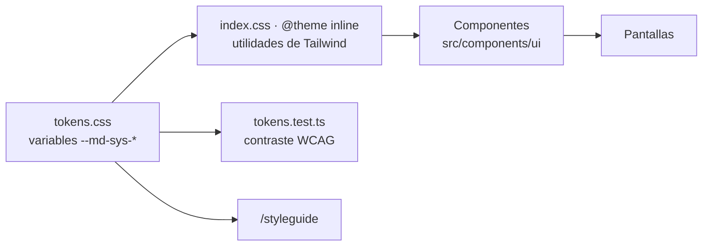

# Sistema de diseño de Rumbo

> Estado: **implementado en el paso 2** (10/11/2026). Los valores de este documento son los de `src/styles/tokens.css` y coinciden con la página interna `/styleguide`, disponible solo con `npm run dev` en `http://localhost:5173/#/styleguide`.

Rumbo usa **Material Design 3** (Google, s.f.) como base: roles de color, escala tipográfica, forma, estados, elevación y patrones de componentes. No usa una librería de Material, sino **Tailwind CSS 4 y shadcn/ui** (con Radix debajo). Así los fundamentos de M3 se convierten en tokens propios y el producto no se ve como una app de Google por defecto.

## 1. Arquitectura de tokens

`tokens.css` es la única fuente de verdad. El tema de Tailwind **borra la paleta, las tipografías, los radios y las sombras por defecto** y solo expone los tokens de Rumbo. Por eso un componente no puede usar `text-sm`, `bg-blue-500` ni `shadow-lg`: esas clases no existen. Un test lee `tokens.css` y verifica el contraste de cada combinación permitida.

## 2. Fundamentos

### 2.1 Color

Carácter frío, limpio y profesional, con fondos blancos y grises fríos. Sin crema, beige, tonos tierra, terracota ni coral.

| Rol | Base | On | Container | On-container | Uso |
| --- | --- | --- | --- | --- | --- |
| `primary` | `#1F6F78` | `#FFFFFF` | `#D8EEF0` | `#0B3B40` | Acción principal, navegación activa, enlaces, foco |
| `secondary` | `#4A6366` | `#FFFFFF` | `#CDE7EA` | `#05363A` | Botones tonales, chips seleccionados |
| `tertiary` | `#9C3D74` | `#FFFFFF` | `#F6DCEA` | `#4A1435` | Acentos puntuales, segunda serie de gráficos |
| `error` | `#B3261E` | `#FFFFFF` | `#F9DEDC` | `#5C1210` | Errores, vencidas, bloqueos, destructivas |
| `success` * | `#2E7D32` | `#FFFFFF` | `#DCEFDD` | `#123D15` | Completadas, confirmaciones |
| `warning` * | `#8A5300` | `#FFFFFF` | `#FCEBC7` | `#4A2C00` | Por vencer, pendientes, bloqueadas por dependencias |
| `info` * | `#2457C5` | `#FFFFFF` | `#DCE6FB` | `#0F2A66` | Avisos, ayuda, novedades |

\* Colores personalizados (*custom colors* de M3), con la misma estructura de roles.

| Superficie o neutro | Valor | Uso |
| --- | --- | --- |
| `surface` | `#F6F8F9` | Fondo de la página |
| `surface-container-lowest` | `#FFFFFF` | Tarjetas, tablas, formularios, relleno de campos |
| `surface-container` | `#EEF2F4` | Sidebar, encabezados de tabla |
| `surface-container-high` | `#E4E9EC` | Hover de filas, selección neutra |
| `on-surface` | `#111827` | Texto principal |
| `on-surface-variant` | `#4B5563` | Texto secundario, íconos |
| `outline` | `#7D8793` | Bordes de campos y controles |
| `outline-variant` | `#D5DBE0` | Bordes de tarjetas y divisores |
| `inverse-surface` / `inverse-on-surface` | `#1F2937` / `#F3F4F6` | Tooltips y toasts |
| `scrim` | `#000000` al 32 % | Fondo detrás de los diálogos |

**Reglas de uso verificadas por el test de contraste** (`src/styles/tokens.test.ts`, 51 casos):
- Todo texto *on* sobre su base y todo *on-container* sobre su container supera 4,5:1.
- Los colores base se usan como texto solo sobre `surface`, `surface-container-lowest` y `surface-container`. **Nunca sobre `surface-container-high`**, porque `success` queda en 4,19:1 (D-21).
- **Píldoras de estado:** fondo container, texto *on-container* e ícono en el color base. El color base como texto sobre su container no llega a 4,5:1 en `success` (4,26:1), así que solo se usa para el ícono, que necesita 3:1 (D-21).
- `outline` llega a 3:1 sobre las tres superficies claras. Los campos siempre tienen relleno blanco, así que su borde siempre contrasta.
- El color nunca es la única señal: todo estado lleva ícono y texto.

**Series de gráficos**, en orden: `#1F6F78`, `#9C3D74`, `#5B8FA8`, `#B9779D` y `#6B7280`. Todas llegan a 3:1 sobre blanco, como pide WCAG para objetos gráficos. La serie 4 reemplaza a `#C98AAE`, que tenía 2,72:1 (D-22). El área bajo la línea va en color plano al 12 %, nunca con degradé.

**Modo oscuro:** los roles están **preparados** en `tokens.css` bajo `[data-theme='dark']`, pero no se usan en la fase A. Antes de activarlos hay que verificarlos con Material Theme Builder.

### 2.2 Tipografía

**Inter** (variable), alojada en el proyecto con `@fontsource-variable/inter`, sin Google Fonts, para respetar la CSP. Todo texto usa un **rol de M3**; los tamaños sueltos no existen en el tema.

| Rol | Clase | Tamaño / interlineado | Peso | Uso |
| --- | --- | --- | --- | --- |
| display-small | `text-display-small` | 36 / 44 | 600 | Solo números de KPIs |
| headline-small | `text-headline-small` | 24 / 32 | 600 | Título de página (único `h1`) |
| title-large | `text-title-large` | 22 / 28 | 600 | Título de sección (`h2`) |
| title-medium | `text-title-medium` | 16 / 24 | 600 | Título de tarjeta, modal o grupo (`h3`) |
| title-small | `text-title-small` | 14 / 20 | 500 | Subtítulos, encabezados de tabla |
| body-large | `text-body-large` | 16 / 24 | 400 | Lectura larga y base en mobile |
| body-medium | `text-body-medium` | 14 / 20 | 400 | Base en desktop, celdas de tabla |
| body-small | `text-body-small` | 12 / 16 | 400 | Texto de ayuda, metadatos, fechas |
| label-large | `text-label-large` | 14 / 20 | 500 | Botones, pestañas, navegación |
| label-medium | `text-label-medium` | 12 / 16 | 500 | Etiquetas de campos, chips, píldoras |
| label-small | `text-label-small` | 11 / 16 | 500 | Solo contadores e insignias |

- Los títulos usan la variante **enfatizada** de M3 Expressive (600).
- Todo en `rem`, para que escale con la configuración del navegador.
- Cifras tabulares en tablas, fechas (`<time>`) y KPIs (`tabular-nums`).
- Texto base del `body`: 16 px en mobile y 14 px desde 1024 px.

### 2.3 Espaciado

Escala de 4 px de Tailwind para el interior de los componentes, más estos tokens de layout:

| Token | Mobile | Tablet (≥ 768) | Desktop (≥ 1280) | Uso |
| --- | --- | --- | --- | --- |
| `--space-gutter` | 16 px | 24 px | 32 px | Margen lateral de la página |
| `--space-bento-gap` | 16 px | 16 px | 20 px | Espacio entre tarjetas bento (igual en toda la grilla) |
| `--space-card-padding` | 20 px | 20 px | 20 px | Padding interno de toda tarjeta |
| `--space-section` | 32 px | 32 px | 32 px | Entre secciones de una página |

### 2.4 Forma

Una sola familia de esquinas suaves, coherente con las referencias:

| Token | Valor | Uso |
| --- | --- | --- |
| `rounded-xs` | 4 px | Elementos internos pequeños |
| `rounded-sm` | 8 px | Botones (forma cuadrada con esquinas suaves de M3 Expressive), campos, chips |
| `rounded-md` | 12 px | Menús, tooltips, toasts, contenedores de tabla |
| `rounded-lg` | 16 px | Tarjetas bento y diálogos |
| `rounded-full` | | Píldoras de estado, barras de progreso |

### 2.5 Elevación

Las tarjetas **no llevan sombra**: la profundidad se marca con los niveles de superficie (elevación tonal de M3) y bordes sutiles. Solo hay dos sombras, neutras y suaves, para lo que flota:

| Token | Uso |
| --- | --- |
| `shadow-elevation-1` | Menús, popovers, tooltips |
| `shadow-elevation-2` | Diálogos, toasts, tarjeta arrastrada en el constructor |

### 2.6 Íconos

**Material Symbols, estilo Rounded, peso 300**, del paquete `@material-symbols/svg-300` (licencia Apache 2.0).
- Un script (`npm run icons`) extrae solo los íconos listados en `scripts/generate-icons.mjs` y genera `icon-paths.generated.ts`. Nunca se carga la fuente completa. Hoy son 90 íconos.
- Todo ícono pasa por `<Icon name="..." />`: 20 px en interfaz densa, 24 px en navegación, y 16 o 18 px solo dentro de píldoras y chips.
- Contorno por defecto; relleno (`filled`) solo para el ítem activo de la navegación y los estados seleccionados.
- Sin `label`, el ícono es decorativo (`aria-hidden`). Los botones de solo ícono usan `<IconButton>`, que exige `label` y muestra tooltip.

### 2.7 Movimiento

Curvas y duraciones de M3, entre 150 y 300 ms:

| Token | Valor | Uso |
| --- | --- | --- |
| `ease-standard` | `cubic-bezier(0.2, 0, 0, 1)` | Cambios de estado, hover |
| `ease-emphasized-decelerate` | `cubic-bezier(0.05, 0.7, 0.1, 1)` | Entradas: tarjetas, progreso |
| `ease-emphasized-accelerate` | `cubic-bezier(0.3, 0, 0.8, 0.15)` | Salidas |
| Duraciones | 150 / 200 / 300 ms | Corta, media y larga |
| Escalonado bento | 40 ms | Entre tarjetas |

- Implementado con **Motion** (`src/lib/motion.ts`) y con las utilidades de entrada y salida de `tw-animate-css` para Radix.
- `useShouldReduceMotion()` combina `prefers-reduced-motion` con la preferencia de la app (`data-reduce-motion` en `<html>`, F17). Con reducción, las tarjetas solo cambian de opacidad y las barras muestran el valor final. El CSS global anula transiciones y animaciones.
- Skeletons con pulso de opacidad (`animate-pulse-soft`), sin degradé animado.

### 2.8 Breakpoints

| Nombre | Desde | Layout |
| --- | --- | --- |
| Mobile | 0 | 1 columna, tablas como tarjetas, áreas táctiles de 48 px |
| `md` (tablet) | 768 px | Grilla bento de 6 columnas |
| `lg` | 1024 px | Texto base de 14 px |
| `xl` (desktop) | 1280 px | Grilla bento de 12 columnas |

## 3. Componentes base

Todos están en `src/components/ui/`, un componente por archivo, y se muestran en `/styleguide`.

### Button
- **Variantes** (jerarquía de M3 Expressive): `filled` (acción principal, **una sola por región**), `tonal`, `outlined`, `text` y `danger` (solo para confirmar acciones destructivas dentro de un modal). No hay *elevated* ni FAB.
- **Tamaños:** `xs` (32 px, filas de tabla y barras densas), `s` (40 px, por defecto) y `m` (56 px, acción principal de pantallas de un paso en mobile).
- **Estados:** reposo, hover y presionado (capa de estado de M3: 8 % y 10 % del color del contenido), foco (anillo `primary` de 2 px con separación), deshabilitado (contenedor al 12 % y contenido al 38 %) y cargando.
- **Cargando:** `loading` muestra el indicador y `loadingText` ("Guardando…") en la misma celda de grilla que la etiqueta, así que el ancho no cambia. El botón mantiene su color y bloquea los clics.
- **Deshabilitado con motivo:** `disabledReason` usa `aria-disabled` en lugar de `disabled`. Así el botón sigue siendo enfocable y el motivo se lee en un tooltip con teclado y con lector de pantalla.
- **Área táctil:** en mobile, un pseudoelemento amplía el área a 48 × 48 px aunque el botón se vea más chico.
- `asChild` aplica el estilo a un enlace del router.

### IconButton
Variantes `standard`, `tonal` y `outlined`; tamaños de 40 y 32 px. `label` es obligatorio y se usa como `aria-label` y como tooltip. `selected` rellena el ícono y expone `aria-pressed`.

### TextField
- Etiqueta visible y permanente arriba (`label-medium`), con "(obligatorio)" u "(opcional)" en texto.
- `helperText` es **obligatorio por diseño**: dice qué poner, en qué formato y con un ejemplo. Se asocia con `aria-describedby`.
- El error reemplaza al texto de ayuda en el mismo lugar, en color `error`, con ícono y `aria-invalid`. Nunca borra el valor cargado.
- Altura de 48 px en mobile y 40 px en desktop. Admite un elemento a la derecha (`trailing`), como mostrar u ocultar la contraseña.
- El texto de ayuda mantiene el contraste completo aunque el campo esté deshabilitado, porque explica por qué lo está.
- El comportamiento de validación (no marcar errores mientras se escribe por primera vez, revalidar al corregir, resumen de errores) se implementa con React Hook Form y Zod en cada formulario, desde el paso 4.

### StatusPill
Tonos `success`, `warning`, `error`, `info`, `primary` y `neutral`. Siempre lleva ícono y texto. Rótulos de estado según [information-architecture.md](information-architecture.md):

| Estado de tarea | Tono | Ícono |
| --- | --- | --- |
| Pendiente | neutral | `radio_button_unchecked` |
| En curso | info | `pending` |
| Hecha | success | `check_circle` |
| Bloqueada | warning | `lock` |
| Vencida | error | `error` |

### FilterChip y SegmentedButton
- **FilterChip:** un *toggle* (`aria-pressed`). Seleccionado, usa `secondary-container` con un check, no solo color. Admite un contador.
- **SegmentedButton:** opciones excluyentes ("Por ingreso" / "Por cohorte"). Siempre queda una opción elegida. Navegación con flechas (Radix ToggleGroup).

### BentoGrid y BentoCard
- **Grilla:** 1 columna en mobile, 6 desde 768 px y 12 desde 1280 px. El espacio entre tarjetas es siempre `--space-bento-gap`.
- **Tamaños:**

| Tamaño | Tablet (de 6) | Desktop (de 12) | Ejemplo |
| --- | --- | --- | --- |
| `sm` | 3 | 3 | KPI |
| `md` | 3 | 4 | Bloque secundario |
| `lg` | 6 | 8 | Gráfico principal |
| `wide` | 6 | 12 | Tablas |
| `tall` | 3 (2 filas) | 4 (2 filas) | Alertas |

- Cada tarjeta es un `section` con título (`h2` o `h3` según el lugar en la página), descripción opcional, contenido y una acción opcional arriba a la derecha.
- Aparecen con fundido y un desplazamiento de 8 px, escalonadas 40 ms.

### ProgressBar
Barra lineal con `role="progressbar"`, nombre accesible y valor. Se llena desde 0 al aparecer y anima los cambios en 300 ms. Tonos `primary` y `success`.

### Skeleton
Bloque con pulso de opacidad, oculto para lectores de pantalla.

### Table
`TableContainer` es una región enfocable con nombre: si la tabla no entra, el desplazamiento ocurre dentro de ella y nunca en la página. Encabezado en `surface-container` con `title-small`; filas con hover en `surface-container-high`. El patrón de tarjetas en mobile se implementa con cada listado, desde el paso 7.

### Dialog y ConfirmDialog
- **Dialog** (Radix): el foco entra al abrir, queda atrapado, se cierra con Escape y vuelve al disparador. Tiene `shadow-elevation-2`, `rounded-lg` y un scrim al 32 %. Las acciones quedan a la derecha en desktop; en mobile se apilan a ancho completo con la principal arriba.
- **ConfirmDialog:** el título dice la consecuencia ("¿Eliminar esta tarea?") y el botón la repite ("Eliminar tarea"). Nunca "Sí / No".

### Toast
`toast.success()`, `toast.info()` y `toast.error()` desde cualquier lugar. Usan Radix Toast, que los anuncia con `aria-live`. Fondo `inverse-surface` con `shadow-elevation-2`, abajo a la derecha (centrado en mobile), con 5 s de duración y botón de cerrar. Los mensajes de éxito van en pasado y son breves ("Plantilla publicada").

### Tooltip
Radix Tooltip: se abre con hover y con foco de teclado. Fondo `inverse-surface`, texto `body-small`, `shadow-elevation-1`.

## 4. Qué se tomó de Material 3 y qué se personalizó

| Aspecto | De Material 3 | Personalizado en Rumbo | Por qué |
| --- | --- | --- | --- |
| Color | Roles (base, on, container, on-container), superficies tonales | Paleta propia de azul petróleo y ciruela; `success`, `warning` e `info` como colores personalizados | Identidad propia; M3 solo trae `error` como estado |
| Tipografía | Escala de roles y variante enfatizada | Inter en lugar de Roboto | Legibilidad en interfaces densas y personalidad propia |
| Forma | Escala de esquinas | Una sola forma de botón (cuadrada, 8 px) sin cambio de forma al presionar | Interfaz sobria y coherente con las referencias |
| Elevación | Elevación tonal | Solo dos sombras y solo para elementos flotantes; sin botones *elevated* | Sensación liviana (CLAUDE.md 2.5) |
| Estados | Capas de estado (8 % y 10 %), opacidades de deshabilitado (12 % y 38 %) | Igual que M3 | Consistencia y accesibilidad |
| Densidad | | Base de 14 px en desktop, botones XS de 32 px en tablas | Herramienta corporativa de uso intensivo |
| Íconos | Material Symbols | Solo Rounded 300, en SVG individual | Peso visual liviano y sin cargar la fuente completa |
| Componentes | Patrones de botón, chip, segmentado, diálogo | Implementados con Tailwind y Radix, no con la librería de Material | Que no se vea como una app de Google por defecto |

## 5. Verificación

| Qué | Cómo | Resultado al 10/11/2026 |
| --- | --- | --- |
| Contraste de tokens | `npm test` (`tokens.test.ts`) | 51/51 |
| Desbordes en 320, 375, 768, 1024, 1280 y 1440 px | `npm run test:e2e` (`e2e/overflow.spec.ts`), capturas en `docs/screenshots/` | 18/18 |
| axe (WCAG 2.2 A y AA) a 375 y 1280 px | `npm run test:e2e` (`e2e/a11y.spec.ts`) | 6/6 sin violaciones |
| Un único `h1` por pantalla | `e2e/a11y.spec.ts` | 3/3 |
| `/styleguide` fuera del build | Búsqueda en `dist/` | No aparece |

## Referencias

Google. (s.f.). *Material Design 3*. https://m3.material.io/

Google. (s.f.). *Material Symbols* [Conjunto de íconos]. https://fonts.google.com/icons

World Wide Web Consortium. (2023). *Web Content Accessibility Guidelines (WCAG) 2.2*. https://www.w3.org/TR/WCAG22/
