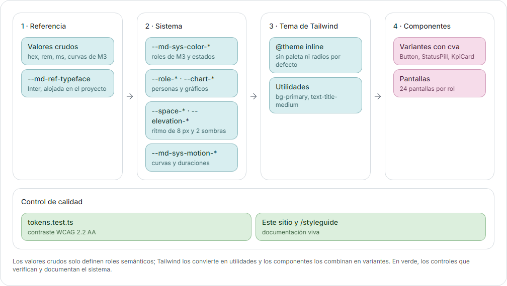

# Sistema de diseño de Rumbo

> **Sitio del sistema de diseño:** [lpedaci.github.io/rumbo-app/#/design-system](https://lpedaci.github.io/rumbo-app/#/design-system) (D-98). Este documento es la versión en Markdown. En tablet y mobile, el sitio se recorre con la barra "Secciones" del encabezado (D-104).
>
> Estado: **implementado en el paso 2** (10/11/2026). Los valores de este documento son los de `src/styles/tokens.css` y coinciden con la página interna `/styleguide`, disponible solo con `npm run dev` en `http://localhost:5173/#/styleguide`.

Rumbo usa **Material Design 3** (Google, s.f.) como base: roles de color, escala tipográfica, forma, estados, elevación y patrones de componentes. No usa una librería de Material, sino **Tailwind CSS 4 y shadcn/ui** (con Radix debajo). Así los fundamentos de M3 se convierten en tokens propios y el producto no se ve como una app de Google por defecto.

## 1. Arquitectura de tokens

Los tokens siguen la organización en niveles que proponen Material 3 y el W3C Design Tokens Community Group: **referencia → sistema → componente**. Cada nivel solo usa el anterior, y los componentes nunca usan un valor suelto.

*Diagrama de niveles de tokens: los valores crudos (nivel 1) solo se usan para definir los roles semánticos (nivel 2); Tailwind los convierte en utilidades (nivel 3) y los componentes los combinan en variantes (nivel 4). En verde, los controles: el test de contraste lee los tokens de sistema, y el sitio del sistema de diseño y `/styleguide` muestran los componentes. El modo oscuro tiene los mismos roles preparados para la fase B.*

`tokens.css` es la única fuente de verdad. El tema de Tailwind **borra la paleta, las tipografías, los radios y las sombras por defecto** y solo expone los tokens de Rumbo. Por eso un componente no puede usar `text-sm`, `bg-blue-500` ni `shadow-lg`: esas clases no existen. Un test lee `tokens.css` y verifica el contraste de cada combinación permitida.

## 2. Fundamentos

### 2.1 Color

Carácter frío, limpio y profesional, con fondos blancos y grises fríos. Sin crema, beige, tonos tierra, terracota ni coral.

| Rol | Base | On | Container | On-container | Uso |
| --- | --- | --- | --- | --- | --- |
| `primary` | `#1F6F78` | `#FFFFFF` | `#D8EEF0` | `#0B3B40` | Acción principal, navegación activa, enlaces, foco |
| `secondary` | `#4A6366` | `#FFFFFF` | `#CDE7EA` | `#05363A` | Botones tonales, chips seleccionados |
| `tertiary` | `#9C3D74` | `#FFFFFF` | `#F6DCEA` | `#4A1435` | Acentos puntuales, segunda serie de gráficos |
| `error` | `#B3261E` | `#FFFFFF` | `#F9DEDC` | `#5C1210` | Errores, vencidas, bloqueos, destructivas |
| `success` * | `#2E7D32` | `#FFFFFF` | `#DCEFDD` | `#123D15` | Completadas, confirmaciones |
| `warning` * | `#8A5300` | `#FFFFFF` | `#FCEBC7` | `#4A2C00` | Por vencer, pendientes, bloqueadas por dependencias |
| `info` * | `#2457C5` | `#FFFFFF` | `#DCE6FB` | `#0F2A66` | Avisos, ayuda, novedades |

\* Colores personalizados (*custom colors* de M3), con la misma estructura de roles.

| Superficie o neutro | Valor | Uso |
| --- | --- | --- |
| `surface` | `#F1F3F5` | Fondo de la página, gris frío neutro (D-69); las tarjetas blancas se despegan con su borde |
| `surface-container-lowest` | `#FFFFFF` | Tarjetas, tablas, formularios, relleno de campos |
| `surface-container` | `#EEF2F4` | Sidebar, encabezados de tabla |
| `surface-container-high` | `#E4E9EC` | Hover de filas, selección neutra |
| `on-surface` | `#111827` | Texto principal |
| `on-surface-variant` | `#4B5563` | Texto secundario, íconos |
| `outline` | `#7D8793` | Bordes de campos y controles |
| `outline-variant` | `#D5DBE0` | Bordes de tarjetas y divisores |
| `inverse-surface` / `inverse-on-surface` | `#1F2A30` / `#FFFFFF` | Tooltips, toasts y tooltip oscuro de gráficos |
| `scrim` | `#000000` al 32 % | Fondo detrás de los diálogos |

**Reglas de uso verificadas por el test de contraste** (`src/styles/tokens.test.ts`, 51 casos):
- Todo texto *on* sobre su base y todo *on-container* sobre su container supera 4,5:1.
- Los colores base se usan como texto solo sobre `surface`, `surface-container-lowest` y `surface-container`. **Nunca sobre `surface-container-high`**, porque `success` queda en 4,19:1 (D-21).
- **Píldoras de estado:** fondo container, texto *on-container* e ícono en el color base. El color base como texto sobre su container no llega a 4,5:1 en `success` (4,26:1), así que solo se usa para el ícono, que necesita 3:1 (D-21).
- `outline` llega a 3:1 sobre las tres superficies claras. Los campos siempre tienen relleno blanco, así que su borde siempre contrasta.
- El color nunca es la única señal: todo estado lleva ícono y texto.

**Series de gráficos**, en orden: `#1F6F78`, `#9C3D74`, `#5B8FA8`, `#B9779D` y `#6B7280`. Todas llegan a 3:1 sobre blanco, como pide WCAG para objetos gráficos. La serie 4 reemplaza a `#C98AAE`, que tenía 2,72:1 (D-22). El área bajo la línea va en color plano al 12 %, nunca con degradé.

**Modo oscuro:** los roles están **preparados** en `tokens.css` bajo `[data-theme='dark']`, pero no se usan en la fase A. Antes de activarlos hay que verificarlos con Material Theme Builder.

### 2.2 Tipografía

**Inter** (variable), alojada en el proyecto con `@fontsource-variable/inter`, sin Google Fonts, para respetar la CSP. Todo texto usa un **rol de M3**; los tamaños sueltos no existen en el tema.

| Rol | Clase | Tamaño / interlineado | Peso | Uso |
| --- | --- | --- | --- | --- |
| display-small | `text-display-small` | 36 / 44 | 600 | Solo números de KPIs |
| headline-small | `text-headline-small` | 24 / 32 | 600 | Título de página (único `h1`) |
| title-large | `text-title-large` | 22 / 28 | 600 | Título de sección (`h2`) |
| title-medium | `text-title-medium` | 16 / 24 | 600 | Título de tarjeta, modal o grupo (`h3`) |
| title-small | `text-title-small` | 14 / 20 | 500 | Subtítulos, encabezados de tabla |
| body-large | `text-body-large` | 16 / 24 | 400 | Lectura larga y base en mobile |
| body-medium | `text-body-medium` | 14 / 20 | 400 | Base en desktop, celdas de tabla |
| body-small | `text-body-small` | 12 / 16 | 400 | Texto de ayuda, metadatos, fechas |
| label-large | `text-label-large` | 14 / 20 | 500 | Botones, pestañas, navegación |
| label-medium | `text-label-medium` | 12 / 16 | 500 | Etiquetas de campos, chips, píldoras |
| label-small | `text-label-small` | 11 / 16 | 500 | Solo contadores e insignias |

- Los títulos usan la variante **enfatizada** de M3 Expressive (600).
- Todo en `rem`, para que escale con la configuración del navegador.
- Cifras tabulares en tablas, fechas (`<time>`) y KPIs (`tabular-nums`).
- Texto base del `body`: 16 px en mobile y 14 px desde 1024 px.

### 2.3 Espaciado

Escala de 4 px de Tailwind para el interior de los componentes, más estos tokens de layout:

| Token | Mobile | Tablet (≥ 768) | Desktop (≥ 1280) | Uso |
| --- | --- | --- | --- | --- |
| `--space-gutter` | 16 px | 24 px | 32 px | Margen lateral de la página |
| `--space-bento-gap` | 16 px | 16 px | 20 px | Espacio entre tarjetas bento (igual en toda la grilla) |
| `--space-card-padding` | 20 px | 20 px | 20 px | Padding interno de toda tarjeta |
| `--space-section` | 32 px | 32 px | 32 px | Entre secciones de una página |

### 2.4 Forma

Una sola familia de esquinas suaves, coherente con las referencias:

| Token | Valor | Uso |
| --- | --- | --- |
| `rounded-xs` | 4 px | Elementos internos pequeños |
| `rounded-sm` | 8 px | Botones (forma cuadrada con esquinas suaves de M3 Expressive), campos, chips |
| `rounded-md` | 12 px | Menús, tooltips, toasts, contenedores de tabla |
| `rounded-lg` | 16 px | Diálogos y paneles internos |
| `rounded-xl` | 20 px | Tarjetas bento, tarjetas de página y panel lateral (2.2.1) |
| `rounded-full` | | Píldoras de estado, barras de progreso |

### 2.5 Elevación

Las tarjetas **no llevan sombra**: la profundidad se marca con los niveles de superficie (elevación tonal de M3) y bordes sutiles. Solo hay dos sombras, neutras y suaves, para lo que flota:

| Token | Uso |
| --- | --- |
| `shadow-elevation-1` | Menús, popovers, tooltips |
| `shadow-elevation-2` | Diálogos, toasts, tarjeta arrastrada en el constructor |

### 2.6 Íconos

**Material Symbols, estilo Rounded, peso 300**, del paquete `@material-symbols/svg-300` (licencia Apache 2.0).
- Un script (`npm run icons`) extrae solo los íconos listados en `scripts/generate-icons.mjs` y genera `icon-paths.generated.ts`. Nunca se carga la fuente completa. Hoy son 90 íconos.
- Todo ícono pasa por `<Icon name="..." />`: 20 px en interfaz densa, 24 px en navegación, y 16 o 18 px solo dentro de píldoras y chips.
- Contorno por defecto; relleno (`filled`) solo para el ítem activo de la navegación y los estados seleccionados.
- Sin `label`, el ícono es decorativo (`aria-hidden`). Los botones de solo ícono usan `<IconButton>`, que exige `label` y muestra tooltip.

### 2.7 Movimiento

Curvas y duraciones de M3, entre 150 y 300 ms:

| Token | Valor | Uso |
| --- | --- | --- |
| `ease-standard` | `cubic-bezier(0.2, 0, 0, 1)` | Cambios de estado, hover |
| `ease-emphasized-decelerate` | `cubic-bezier(0.05, 0.7, 0.1, 1)` | Entradas: tarjetas, progreso |
| `ease-emphasized-accelerate` | `cubic-bezier(0.3, 0, 0.8, 0.15)` | Salidas |
| Duraciones | 150 / 200 / 300 ms | Corta, media y larga |
| Escalonado bento | 40 ms | Entre tarjetas |
| Escalonado de listas (G0) | 50 ms | `data-stagger` con `useRevealOnce`: fundido y 16 px de subida al entrar en pantalla, una vez; `sides` entra desde los costados alternados (D-92) |

- Implementado con **Motion** (`src/lib/motion.ts`) y con las utilidades de entrada y salida de `tw-animate-css` para Radix.
- `useShouldReduceMotion()` combina `prefers-reduced-motion` con la preferencia de la app (`data-reduce-motion` en `<html>`, F17). Con reducción, las tarjetas solo cambian de opacidad y las barras muestran el valor final. El CSS global anula transiciones y animaciones.
- Skeletons con pulso de opacidad (`animate-pulse-soft`), sin degradé animado.

### 2.8 Breakpoints

Ancho del contenido: hasta el 80 % del área disponible y nunca menos de 1.280 px (`max-w-[max(80rem,80%)]`, D-64).

| Nombre | Desde | Layout |
| --- | --- | --- |
| Mobile | 0 | 1 columna, tablas como tarjetas, áreas táctiles de 48 px |
| `md` (tablet) | 768 px | Grilla bento de 6 columnas |
| `lg` | 1024 px | Texto base de 14 px |
| `xl` (desktop) | 1280 px | Grilla bento de 12 columnas |

## 3. Componentes base

Todos están en `src/components/ui/`, un componente por archivo, y se muestran en `/styleguide`.

### Button
- **Variantes** (jerarquía de M3 Expressive): `filled` (acción principal, **una sola por región**), `tonal`, `outlined`, `text` y `danger` (solo para confirmar acciones destructivas dentro de un modal). No hay *elevated* ni FAB.
- **Tamaños:** `xs` (32 px, filas de tabla y barras densas), `s` (40 px, por defecto) y `m` (56 px, acción principal de pantallas de un paso en mobile).
- **Estados:** reposo, hover y presionado (capa de estado de M3: 8 % y 10 % del color del contenido), foco (anillo `primary` de 2 px con separación), deshabilitado (contenedor al 12 % y contenido al 38 %) y cargando.
- **Cargando:** `loading` muestra el indicador y `loadingText` ("Guardando…") en la misma celda de grilla que la etiqueta, así que el ancho no cambia. El botón mantiene su color y bloquea los clics.
- **Deshabilitado con motivo:** `disabledReason` usa `aria-disabled` en lugar de `disabled`. Así el botón sigue siendo enfocable y el motivo se lee en un tooltip con teclado y con lector de pantalla.
- **Área táctil:** en mobile, un pseudoelemento amplía el área a 48 × 48 px aunque el botón se vea más chico.
- `asChild` aplica el estilo a un enlace del router.

### IconButton
Variantes `standard`, `tonal` y `outlined`; tamaños de 40 y 32 px. `label` es obligatorio y se usa como `aria-label` y como tooltip. `selected` rellena el ícono y expone `aria-pressed`.

### TextField
- Etiqueta visible y permanente arriba (`label-medium`), con "(obligatorio)" u "(opcional)" en texto.
- `helperText` es **obligatorio por diseño**: dice qué poner, en qué formato y con un ejemplo. Se asocia con `aria-describedby`.
- El error reemplaza al texto de ayuda en el mismo lugar, en color `error`, con ícono y `aria-invalid`. Nunca borra el valor cargado.
- Altura de 48 px en mobile y 40 px en desktop. Admite un elemento a la derecha (`trailing`), como mostrar u ocultar la contraseña.
- El texto de ayuda mantiene el contraste completo aunque el campo esté deshabilitado, porque explica por qué lo está.
- **Máscaras de entrada** (`mask`, en `src/lib/input-masks.ts`): impiden escribir o pegar caracteres que no corresponden al dato. Son filtros, no validaciones:

| Máscara | Campo | Qué hace |
| --- | --- | --- |
| `dateMask` | Fechas DD/MM/AAAA | Solo dígitos, agrega las barras al escribir, máximo 8 dígitos; acepta pegar "13-10-2026" |
| `integerMask` | Plazos en días, cantidades | Solo dígitos y, si se permite, un signo menos inicial; sin decimales ni "e" |
| `digitsMask(6)` | Código de verificación | Solo 6 dígitos; quita los espacios al pegar |
| `noSpacesMask` | Correos | Quita los espacios |

  Si se escribe o se pega un carácter que la máscara descarta, `TextField` avisa a los lectores de pantalla con una región `aria-live` cortés que incluye el valor final, por ejemplo: "Ese carácter no se acepta en este campo. Valor actual: 13" (D-28).
  Los campos con máscara usan `type="text"` (no `type="number"`, que acepta "e", "+" y decimales) e ignoran el `maxLength` nativo: el navegador cortaría el texto pegado antes de limpiarlo (INC-005).
- **Validación** con React Hook Form y Zod (`src/lib/validation.ts`), en modo `onTouched`: la primera validación ocurre al salir del campo o al enviar; después de un error, el campo se revalida en cada cambio y el mensaje desaparece apenas el dato es correcto. Al enviar, el foco va al primer campo con error. Los valores nunca se borran.
- Los mensajes son claves de i18n (`validation.*`) y dicen qué corregir, por ejemplo: "Esa fecha no existe. Revisa el día y el mes". Las fechas se validan contra el calendario (31/02 no pasa).
- Hay un formulario de ejemplo funcionando en `/styleguide`. El resumen de errores para formularios largos se agrega con el primer formulario largo (A3, paso 7).

### StatusPill
Tonos `success`, `warning`, `error`, `info`, `primary` y `neutral`. Siempre lleva ícono y texto. Rótulos de estado según [information-architecture.md](information-architecture.md):

| Estado de tarea | Tono | Ícono |
| --- | --- | --- |
| Pendiente | neutral | `radio_button_unchecked` |
| En curso | info | `pending` |
| Hecha | success | `check_circle` |
| Bloqueada | warning | `lock` |
| Vencida | error | `error` |

### FilterChip y SegmentedButton
- **FilterChip:** un *toggle* (`aria-pressed`). Seleccionado, usa `secondary-container` con un check, no solo color. Admite un contador.
- **SegmentedButton:** opciones excluyentes ("Por ingreso" / "Por cohorte"). Siempre queda una opción elegida. Navegación con flechas (Radix ToggleGroup).

### BentoGrid y BentoCard
- **Grilla:** 1 columna en mobile, 6 desde 768 px y 12 desde 1280 px. El espacio entre tarjetas es siempre `--space-bento-gap`.
- **Tamaños:**

| Tamaño | Tablet (de 6) | Desktop (de 12) | Ejemplo |
| --- | --- | --- | --- |
| `sm` | 3 | 3 | KPI |
| `md` | 3 | 4 | Bloque secundario |
| `lg` | 6 | 8 | Gráfico principal |
| `wide` | 6 | 12 | Tablas |
| `tall` | 3 (2 filas) | 4 (2 filas) | Alertas |

- Cada tarjeta es un `section` con título (`h2` o `h3` según el lugar en la página), descripción opcional, contenido y una acción opcional arriba a la derecha.
- Aparecen con fundido y un desplazamiento de 8 px, escalonadas 40 ms.

### ProgressBar
Barra lineal con `role="progressbar"`, nombre accesible y valor. Se llena desde 0 al aparecer y anima los cambios en 300 ms. Tonos `primary` y `success`.

### Skeleton
Bloque con pulso de opacidad, oculto para lectores de pantalla.

### Table
`TableContainer` es una región enfocable con nombre: si la tabla no entra, el desplazamiento ocurre dentro de ella y nunca en la página. Encabezado en `surface-container` con `title-small`; filas con hover en `surface-container-high`. El patrón de tarjetas en mobile se implementa con cada listado, desde el paso 7.

### Dialog y ConfirmDialog
- **Dialog** (Radix): el foco entra al abrir, queda atrapado, se cierra con Escape y vuelve al disparador. Tiene `shadow-elevation-2`, `rounded-lg` y un scrim al 32 %. Las acciones quedan a la derecha en desktop; en mobile se apilan a ancho completo con la principal arriba.
- **ConfirmDialog:** el título dice la consecuencia ("¿Eliminar esta tarea?") y el botón la repite ("Eliminar tarea"). Nunca "Sí / No".

### Toast
`toast.success()`, `toast.info()` y `toast.error()` desde cualquier lugar. Usan Radix Toast, que los anuncia con `aria-live`. Fondo `inverse-surface` con `shadow-elevation-2`, abajo a la derecha (centrado y por encima del menú inferior en mobile), con 5 s de duración y botón de cerrar. Se ve uno a la vez: el nuevo reemplaza al anterior (D-90). Los mensajes de éxito van en pasado y son breves ("Plantilla publicada").

### IconTile, KpiCard y KpiRow (rediseño 2.2.1)
- **IconTile:** ícono dentro de un contenedor de color (`primary`, `secondary`, `tertiary`, `brand` y los tonos de estado solo para estados). Decorativo.
- **KpiCard:** ícono y sparkline arriba, etiqueta (hasta dos líneas), número con la frase al lado si entra (si no, debajo, D-90) y debajo su píldora de variación o estado. Padding de 16 px hasta 1279 px (D-91). Datos alineados abajo para que las tarjetas de una fila queden parejas. Número en `display-small` desde 768 px y `headline-small` en mobile (D-63).
- **KpiRow:** fila de KPIs a todo el ancho de la grilla: 2 por fila en mobile; desde 768 px, tantas por fila como entren con un ancho mínimo de 9 rem (`minCardWidth`), así 4 KPIs breves comparten una línea en tablet y desktop, y las tarjetas con más contenido pasan solas a una segunda línea (D-68). Entre 768 y 1279 px la tarjeta usa padding de 12 px, sparkline de 64 px y número en `headline-small`.
- **Barra superior:** 12 px entre botones en mobile y 16 px desde 640 px, para que los objetivos táctiles no queden pegados (D-68).

### Sparkline
Línea suave en `primary` o `tertiary` con relleno plano al 12 % y punto final. Decorativa: el valor y su variación siempre van escritos al lado. El trazo no se deforma al estirarla (`non-scaling-stroke`) y el punto final es un elemento aparte, así sigue redondo en las vistas previas anchas (D-92).

### SegmentedProgress
Barritas finas (30 por defecto) que se llenan en proporción al avance; anuncia la cantidad real ("13 de 18 tareas hechas"). Se usa en las vistas previas de G0 y G1 y en la bienvenida guiada (D-56).

### GreetingHeader
Encabezado de inicio de cada rol (D-67): fecha de hoy con ícono, saludo con el nombre en `primary` (único `h1`) y chips de contexto con ícono y texto; el chip que pide atención va en `tertiary-container`.

### Fila de tarea (TaskRow)
Patrón de lista estándar (D-65): control o ícono a la izquierda; título y "Tipo · Responsable" al medio (y el motivo si está bloqueada); fecha con "Vence en…" y estado a la derecha, en columnas fijas desde 640 px. Toda la fila es el enlace (enlace estirado) y el hover pinta un fondo dentro de sus márgenes, sin subrayado. El control de completar queda por encima del enlace.

### Lista de detalles
En las fichas (N2 y siguientes), los datos van como `dl` con etiqueta a la izquierda y valor a la derecha, separados por divisores, y los datos clave como chips bajo el título.

### Línea de tiempo del recorrido (N1)
Un tramo por etapa relleno según sus tareas hechas, marcador "Hoy · día N" en `tertiary`, y bajo cada tramo nombre, "N de M" y estado con ícono y texto. Cada tramo es un `progressbar` con nombre y valor; la misma información está en una tabla solo para lectores de pantalla, sin botón visible (D-61, D-83).

### Avatar
Cada rol tiene su color (D-69): RRHH `role-hr`, jefes `role-manager`, nuevos ingresos `role-hire` y sistemas `role-it`. Con foto, anillo de 2 px del color del rol; sin foto, iniciales sobre el contenedor del rol. Tienen foto las cuatro personas de demo y Nicolás Acosta, el buddy de Sofía (D-84). Fotos de personas: Magnific (magnific.com, antes Freepik), con licencia confirmada por Lourdes para un portfolio público. Detalle de cada archivo en `src/assets/avatars/SOURCE.md`.

### Popover
Panel flotante anclado a su disparador (`--elevation-1`). Al abrir, el foco va al panel (que se anuncia con su nombre); cierra con Escape o clic afuera y devuelve el foco. Se usa en los contactos clave.

### Navegación (G6)
- **Barra lateral (desde 768 px):** panel blanco flotante a todo el alto; arriba, el rótulo "Menú" (solo expandida) y el botón de plegar, sin repetir el logo, que está en la barra superior (D-101). Expandida: ícono + texto; plegada: solo íconos con tooltip y nombre accesible. El ítem activo va en `primary` con ícono relleno. La preferencia se guarda en el navegador.
- **Barra superior:** sobre el fondo, sin franja: logo en una línea ("Rumbo | Nortia S.A."), "Ver como", Ayuda, Notificaciones y la persona como avatar (D-64). Controles con la forma única de 2.1.3, sin círculos ni píldoras con borde (D-62).
- **Mobile:** el botón de menú abre un panel lateral (foco al primer ítem, vuelve al botón al cerrar); barra superior y menú inferior solo con íconos.

### Bienvenida guiada
Diálogo de 3 pasos con ilustración hecha con componentes reales, puntos de progreso, "Saltar", "Anterior" (oculto en el primer paso) y "Continuar". Transición lateral; solo opacidad con movimiento reducido.

### Tooltip
Radix Tooltip: se abre con hover y con foco de teclado. Fondo `inverse-surface`, texto `body-small`, `shadow-elevation-1`.

## 4. Qué se tomó de Material 3 y qué se personalizó

| Aspecto | De Material 3 | Personalizado en Rumbo | Por qué |
| --- | --- | --- | --- |
| Color | Roles (base, on, container, on-container), superficies tonales | Paleta propia de azul petróleo y ciruela; `success`, `warning` e `info` como colores personalizados | Identidad propia; M3 solo trae `error` como estado |
| Tipografía | Escala de roles y variante enfatizada | Inter en lugar de Roboto | Legibilidad en interfaces densas y personalidad propia |
| Forma | Escala de esquinas | Una sola forma de botón (cuadrada, 8 px) sin cambio de forma al presionar | Interfaz sobria y coherente con las referencias |
| Elevación | Elevación tonal | Solo dos sombras y solo para elementos flotantes; sin botones *elevated* | Sensación liviana (CLAUDE.md 2.5) |
| Estados | Capas de estado (8 % y 10 %), opacidades de deshabilitado (12 % y 38 %) | Igual que M3 | Consistencia y accesibilidad |
| Densidad | | Base de 14 px en desktop, botones XS de 32 px en tablas | Herramienta corporativa de uso intensivo |
| Íconos | Material Symbols | Solo Rounded 300, en SVG individual | Peso visual liviano y sin cargar la fuente completa |
| Componentes | Patrones de botón, chip, segmentado, diálogo | Implementados con Tailwind y Radix, no con la librería de Material | Que no se vea como una app de Google por defecto |

## 5. Verificación

| Qué | Cómo | Resultado |
| --- | --- | --- |
| Contraste de tokens | `npm test` (`tokens.test.ts`) | 51/51 |
| Desbordes en 320, 375, 768, 1024, 1280 y 1440 px y axe (WCAG 2.2 A y AA) | `npx playwright test` (`e2e/overflow.spec.ts`, `e2e/a11y.spec.ts`), capturas en `docs/screenshots/` | 279/279 al 11/11/2026 |
| Un único `h1` por pantalla | `e2e/a11y.spec.ts` | 3/3 |
| `/styleguide` fuera del build | Búsqueda en `dist/` | No aparece |

## 6. Cambios por decisión

Ajustes posteriores a la primera versión, en el orden en que se tomaron. Cada uno remite a su decisión en `docs/decisions.md`.

### Colores por rol, avatares y barra superior (D-69)

| Rol | Token base | Contenedor | Uso |
| --- | --- | --- | --- |
| RRHH | `role-hr` #1F6F78 | `role-hr-container` #D8EEF0 | Anillo de la foto, barra y chip de la tarjeta de rol |
| Jefe directo | `role-manager` #9C3D74 | `role-manager-container` #F6DCEA | Ídem |
| Nuevo ingreso | `role-hire` #6A4FC4 | `role-hire-container` #E8E1FB | Ídem |
| Sistemas | `role-it` #2457C5 | `role-it-container` #DCE6FB | Ídem |

- Los colores de rol identifican personas; nunca indican estados.
- **Avatar:** foto si existe en `src/assets/avatars/` (anillo de 2 px del color del rol, separado 2 px); si no, iniciales sobre el contenedor del rol. Siempre decorativo (`alt=""`), con el nombre al lado.
- **Barra superior:** barra blanca flotante con borde y radio `xl`, con botones de utilidad sobre `surface-container`, divisores verticales y la persona con foto, nombre y correo desde 1024 px.
- **Ritmo vertical de los flujos de acceso:** 32 px entre secciones, 8 a 16 px dentro de cada una.
- **Aviso de tarea bloqueada (N2):** sección en `warning-container` con candado, explicación y una fila por tarea previa (tipo, título enlazado, responsable en chip, vencimiento, "Ir a la tarea").

### Página de inicio de la demo, G0 (D-70)

- **Encabezado de sección** (`SectionHeading`): etiqueta con punto `primary`, `h2` en `headline-small` (mobile) o `display-small`, y una línea en `body-large`. Centrado.
- **Escenas:** tarjetas con una zona `surface-container` de 160 a 176 px con mini interfaces hechas con piezas de Rumbo (filas, chips, línea de tiempo, código de verificación). Son decorativas (`aria-hidden`); el título y el texto de la tarjeta dicen lo mismo.
- **Bento de la solución:** grilla de 6 columnas desde 768 px: tres tarjetas de 2 columnas y abajo una de 4 y una de 2.
- **Banda de cifras:** bloque `primary` plano con tarjetas blancas (ícono, número y etiqueta). Es la única zona de color fuerte de la página. Números calculados desde los datos.
- **Preguntas frecuentes:** acordeón de Radix, filas numeradas, una abierta a la vez.
- **Pie:** tarjeta blanca con logo, aviso de demo, enlaces, "Restablecer demo", autoría, crédito de las fotos y la marca "Rumbo" en `primary-container` como SVG decorativo, cortada por el borde.

### G0 en página blanca (D-73)

Reemplaza las bandas de color de D-72.

- **Fondo:** `surface-container-lowest` en toda la página; el hero suma una cuadrícula SVG de 48 px en #EDF0F3.
- **Encabezado de sección:** centrado; etiqueta `label-large` en `primary` (texto simple), `h2` en `headline-small` o `display-small` y una línea en `body-large`.
- **Hero:** `h1` centrado con la parte final en `primary`; acción filled y enlace de texto; cuatro tarjetas flotantes con `--elevation-1` (representan ventanas sobre la página) desde 1280 px.
- **Cifras:** `display-small` a `display-medium`, alternando `primary` y `tertiary`, con la etiqueta debajo.
- **Franja final:** tarjeta `primary-container` con título, texto y la acción principal.

### Bandas y encabezados de G0 (D-72, reemplazado por D-73)

| Banda | Superficie |
| --- | --- |
| Hero | `surface` con cuadrícula SVG de 48 px en #E3E8EC |
| El problema | `band-plum` #FBF0F6 |
| La solución y Preguntas | `surface-container-lowest` |
| Recorridos | `surface` |
| Cifras | `inverse-surface` #1F2A30 con texto `inverse-on-surface` |
| Pasos | `band-petrol` #E4F1F2 |

- **Encabezado de sección:** `h2` en `headline-small` (mobile) o `display-small` y una línea en `body-large`, alineados a la izquierda. Sin etiquetas, números ni líneas decorativas.
- **Pie:** títulos de columna en `title-medium` y `on-surface` con borde inferior; enlaces en `body-medium` y `on-surface-variant`.

### G0 reconstruida y página de error (D-71)

- **Sección por rol:** grilla de 2 columnas desde 1024 px que alterna lados; texto (foto `lg`, chip del rol, `h3` en `headline-small`, `body-large`, puntos como chips con check del color del rol, botón outlined "Recorrer como…") y miniatura en un marco (`AppFrame`: riel de íconos, borde, `--elevation-1` porque representa una ventana flotante) sobre el contenedor plano del rol.
- **Pasos numerados:** cuadrado `primary` de 36 px con el número, título `title-medium` y texto.
- **Pie:** columnas con título `label-large` en `on-surface-variant` y enlaces de texto `body-medium` de 44 px de alto en mobile (36 px desde 768 px); barra inferior en `body-small`.
- **Página de error:** tarjeta centrada con ícono en `error-container`, `h1`, texto sin culpar, "Recargar la página" (filled) y "Volver al inicio" (outlined), "Restablecer demo" (text) con su explicación, y el detalle técnico en un `
` plegado.

### Ajustes de G0 (D-74)

- **Títulos de sección:** hasta 56 rem, `headline-small` → `display-small` (768 px) → `display-medium` (1024 px), `text-balance`; las palabras clave en `primary` (`withHighlight`). Sin punto final.
- **Animación de entrada (`Reveal`):** fundido y 16 px hacia arriba, 450 ms, curva enfatizada; el hero al cargar con pasos de 50 ms y las tarjetas del hero desde 300 ms; las secciones una vez al entrar en pantalla. Con reducir animaciones, solo fundido.
- **Barra de G0 en mobile:** botón de menú (`IconButton` sobre `surface-container`) con las secciones, "Elegir un recorrido" y el case study.
- **Pie en mobile:** un grupo por fila con sus enlaces en línea; desde 640 px, columnas.

### Chips de referencia, contactos y fechas de tareas (D-83, D-84)

- **`RefChip`** (`src/components/ui/RefChip.tsx`): chip en línea, 24 px de alto, `primary-container` con ícono de 16 px y `label-medium`. Señala otra sección o un control dentro de una frase. Con `targetId` es un botón que hace scroll al destino y le pasa el foco; con `to`, un enlace de la app; sin destino, un chip simple. Foco visible con anillo `primary`.
- **Contactos clave (N1):** desde 1024 px, tarjetas con foto `lg` y anillo del rol, chip de relación en el contenedor del rol, nombre (`title-medium`), puesto y correo con ícono. Por debajo de 1024 px, fila compacta con popover.
- **Línea de tiempo:** sin "Ver como tabla"; la tabla accesible vive en un contenedor `sr-only`.
- **Fecha en filas de tareas:** vencimiento relativo en `label-medium` (`on-surface`, o `error` si venció) y fecha exacta en `body-small` `on-surface-variant`; por debajo de 640 px, solo el relativo. Tareas hechas: "Hecha el" y la fecha, en gris.

### Pie de formulario, línea de tiempo de check-ins y escala responsiva (D-85)

- **`FormFooter`** (`src/components/ui/FormFooter.tsx`): franja blanca (`surface-container-lowest`, D-86) con borde superior `outline-variant`, que llega a los bordes de la tarjeta y redondea sus esquinas inferiores. A la izquierda, una nota opcional (`body-small` con ícono); a la derecha, las acciones (secundaria y luego principal). Se reacomoda según el ancho de la tarjeta, no de la pantalla (D-103): por debajo de 36 rem la nota va arriba y los botones abajo, a ancho completo con la principal arriba. Se usa en N3, J3 y A3.
- **`TaskRow`**: también por contenedor (D-103); desde 32 rem de fila, fecha y estado en columnas a la derecha; más angosta, debajo del título, y el estado baja si no entra junto a la fecha.
- **Notificaciones** (F7, D-105): campana de 40 px sobre `surface-container` con insignia `label-small` en `error` (contador, "9+" desde 10) y nombre accesible con la cantidad; panel `PopoverContent` de 26 rem con los 5 más nuevos. `NotificationItem`: ícono del tipo en `IconTile` (tonos de estado solo para estados), título, mensaje y fecha; las no leídas con fondo `primary-container` al 40 % y un punto `primary` más el texto oculto "No leída" (nunca solo color); toda la fila es el enlace. Filtros de G9 con el patrón de los listados (D-107): chips desde 640 px y menús lado a lado en celulares. Espaciado de la lista de alertas de A1 (D-106): divisores entre filas, `px-2 py-3`, 12 px entre ícono y texto y 6 px entre líneas.
- **`TemplateStatePill`** (F8, D-108): estado de una plantilla como píldora: "Borrador" (neutral), "Publicada · vN" (`success`) o "vN · con borrador" (`info`). **`TemplateDiffView`**: cambios entre versiones agrupados en agregadas, quitadas y modificadas, cada grupo con ícono y cantidad.
- **Correos** (D-110): nunca se cortan con puntos suspensivos; pasan a la línea siguiente. **`PageHeader`** (D-111): 8 px entre título y descripción y 12 px bajo la línea superior.
- **`CommentThread`** (F9, D-112): lista con divisores (avatar, nombre, fecha, "editado", texto plano con las menciones en `primary`), campo con texto de ayuda, chips "Mencionar a…" y pie de formulario con "Enviar comentario". En las filas de tareas de J2 y A4, botón con ícono `chat` y la cantidad, con nombre accesible "Comentarios de la tarea: N comentarios".
- **Privacidad** (F10, D-113): `MaskedValue` muestra solo los últimos 4 dígitos y, para RRHH, un botón de texto "Mostrar" que abre un diálogo con el motivo obligatorio. `PrivacyStatusPill`: "Nueva" (`info`), "En curso" (`warning`), "Respondida" (`success`), "Rechazada" (`error`). El aviso G8 usa el patrón de flujo por pasos (puntos, "Anterior" oculto en el primer paso, acción principal a la derecha) sobre el marco de las pantallas de acceso.
- **Sesiones y alertas** (F11, D-114): `SessionRow` con ícono del dispositivo (`computer`, `mobile`), dispositivo y navegador, lugar y último uso, y la píldora "Esta sesión". "¿Fuiste tú?" es una sección en `warning-container` con el ícono `gpp_maybe`, "Sí, fui yo" (outlined) y "No fui yo" (filled). Las solicitudes urgentes llevan la píldora "Urgente" (`error`, con ícono).
- **Personas** (F15, D-116): `RoleChip` con el color del rol (identifica, nunca indica estado) y `PersonStatusPill` ("Activa", "Bloqueada", "Dada de baja"). Las filas de catálogo siguen el patrón de lista con las acciones en un menú; las que no se pueden eliminar lo explican en el mismo menú.
- **Movimientos de accesos** (F12, D-117): `EventSummary` sigue el ritmo de las listas (persona, chip del tipo con ícono, puestos y fecha efectiva, barra de avance "N de M accesos listos"; estado a la derecha) y `AccessTaskList` muestra cada acceso con su ícono de estado y "Marcar como hecho", que pasa debajo del texto cuando el contenedor mide menos de 28 rem (container query). El separador "·" antes de la fecha solo aparece desde 640 px.
- **Estado en las filas de lista** (D-106, D-115, D-119): desde 640 px, el estado y su dato (plazo, acción) van en la columna derecha; en celulares, en una línea propia debajo del contenido, desde el borde izquierdo de la fila (`self-start`, sin estirarse). Lo cumplen A8, A9, A11, A12, G5 y S7.
- **Exportar e imprimir** (F16, D-128): "Descargar CSV" outlined XS con ícono `download` en cada fila de A13; `PrintButton` outlined con ícono `print` en A1, A4 y S6. Los estilos de impresión ocultan todo lo marcado con `data-print-hide` (barra superior, menú, avisos, volver arriba y los propios botones) y dejan la página en blanco.
- **Carga de una pantalla** (`PageSkeleton`, D-131): título, línea de propósito y un bento de tarjetas con el pulso suave de 2.6, dentro del layout (la barra y el menú siguen visibles); se anuncia una vez como "Cargando…".
- **Salir con cambios sin guardar** (D-131): diálogo "Tienes cambios sin guardar" con Quedarme y Descartar cambios (outlined) y Guardar borrador y salir (filled); el mismo para el menú, Volver, el botón Atrás y "Ver como".
- **Resumen de errores** (`ErrorSummary`, D-130): en formularios largos (A3, A6, J3), un `InlineAlert` de error arriba con el título "Revisa N campos antes de continuar" y una línea por campo ("Campo: qué corregir") subrayada que lleva el foco al campo. Toma el foco en cada intento de envío; mientras se corrige, se actualiza sin mover el foco.
- **Casilla** (`Checkbox`): la fila mide 48 px en mobile y la casilla suma un área táctil invisible de 48 × 48 px, como los botones (D-130).
- **Preferencias** (F17, D-129): G11 es un formulario en una tarjeta con secciones separadas por divisor: idioma con botón segmentado, zona horaria y formato de fecha como selects apilados con un ejemplo en el texto de ayuda, una fila por tipo de aviso con botón segmentado (App, Correo, Ambos) y dos casillas de accesibilidad; pie anclado con "Guardar preferencias". **Alto contraste** (`:root[data-contrast='high']`): `primary` #0F4F56, `on-surface-variant` #1F2937, `outline` #4B5563, `outline-variant` #6B7280 y fondo blanco.
- **Ayuda de la pantalla** (F16, D-127): ítem "Ayuda de esta pantalla" en el menú Ayuda; diálogo con el propósito en `body-medium` y "Qué puedes hacer acá" con tres puntos con ícono `check_circle`. **Bienvenidas** de los cuatro roles con la misma anatomía (patrón 9).
- **Búsqueda global** (F16, D-126): botón con forma de campo (borde `outline`, ícono `search`, "Buscar en Rumbo" y la tecla `Ctrl K` en `label-small`) desde 1440 px e ícono sobre `surface-container` por debajo. El diálogo tiene un campo con etiqueta y texto de ayuda, resultados por tipo con el ritmo de las listas y "Ver los N resultados" como enlace con flecha.
- **`EmailText`** (D-125): los correos se muestran completos; si no entran, pasan a dos líneas antes de la "@".
- **Ventanas de detalle** (D-123): persona o ícono con el estado arriba a la derecha, una lista `dl` con etiqueta y valor en la misma fila (divisores `outline-variant`, 12 px arriba y abajo), y después las secciones con `h3` (motivo, detalle, accesos). Lo siguen A12, S7 y A11.
- **Vista previa del hero de G0** (D-123): desde 640 px (en celulares, solo el texto), tres pantallas chicas superpuestas (la del medio al frente, con `--elevation-1`), cada una en un marco `surface` con borde y recortada en 16:10, desvanecidas juntas hacia abajo con `mask-image` (transparencia, no degradé de color).
- **Roles siempre como `RoleChip`** (D-69, D-122): cuando un rol se muestra como dato (qué cambia en S7, la fila de rol en J4 y S6, "Tu cuenta" en G5), va en `RoleChip` con el color del rol; un cambio se lee "chip → chip" con el ícono `arrow_forward` y el texto oculto "pasa a". En frases, historial y auditoría queda como texto.
- **Bloqueo por mínimo de sistemas** (D-121): el mensaje va donde está el problema (en el campo "Nuevo rol" o "Persona", o como aviso de error en el diálogo de revocación, que pasa a "Entendido"); en S7, "Aprobar y aplicar" se deshabilita con el motivo al lado. La fila de la campaña muestra "Revocación bloqueada" en `error` con el ícono `block`.
- **Aprobaciones** (F14, D-118): `ApprovalRow` sigue el ritmo de las listas (persona o ícono de política, título, "de → a", número y quién lo pidió, y una tercera línea si quien mira no puede decidirla); en celulares el estado va debajo del contenido, como en todas las listas (D-119). El detalle muestra los datos en filas etiqueta y valor, el motivo, un aviso informativo cuando no se puede decidir y "Rechazar" (outlined) y "Aprobar y aplicar" (filled). En S3, cada política con un cambio pendiente suma una línea en `warning` con ícono. La solicitud propia muestra "Esperando a…" en la fila; en el detalle, el aviso dice quién la decide y, si esa persona no tiene cuenta de demo, un botón de texto "Resolver como … (demo)" abre la decisión con un aviso que lo rotula como atajo y "Volver sin decidir".
- **Revisión de accesos** (F13, D-120): en J4, una sección por persona (foto, nombre, puesto, avance y "Mantener los N pendientes" como botón de texto) con una fila por acceso: ícono `key` o `admin_panel_settings` en `IconTile` neutro, acceso y tipo, y a la derecha "Mantener" y "Revocar" (outlined XS) o el estado; las personas ya revisadas se pliegan con "Ver los N accesos". Revocar abre un diálogo con motivo obligatorio y el botón de error. S5 y S6 siguen el patrón de listas (D-119); en S6, el cierre explica por qué no se puede cerrar todavía y, en celulares, "Cerrar campaña" va arriba de "Descargar resumen".
- **`BackToTop`** (`src/components/layout/BackToTop.tsx`, D-104): botón flotante de 48 px en la esquina inferior derecha, blanco con borde y `--elevation-1`, que aparece después de 480 px de desplazamiento y lleva el foco al `h1`.
- **`AuthorLinks`** (`src/components/brand/AuthorLinks.tsx`, D-102, D-103): autoría en una línea con botones de ícono a LinkedIn, portfolio y GitHub; se usa en el pie de G0 y en el del sitio.
- **`CheckinTimeline`** (`src/features/hires/CheckinTimeline.tsx`): marcadores de 32 px (hecho en `success-container`, próximo en `primary`, más adelante en `surface-container`) unidos por una línea `outline-variant`. El próximo va en un bloque `surface-container` con el estado de la autoevaluación y la acción; los hechos, con una línea de resultado y el detalle en un `details` nativo ("Ver detalle", accesible por teclado).
- **`ChoiceGroup` en escala:** con container query; lista vertical de opciones con ícono, texto y check por debajo de 32 rem de ancho del formulario, cinco columnas desde ahí.
- **Barra de desplazamiento de la página** (D-86): oculta por debajo de 1024 px; visible en desktop.

### Panel de seguimiento A1 (D-87)

- **Gráficos (Recharts 2.15.4):** área con trazo de 2 px y relleno plano al 12 % de `--chart-1`; barras horizontales con radio de 6 px, la mayor en `--chart-2` (ciruela) y el resto en `--chart-1`; ejes sin líneas, rejilla horizontal `outline-variant`; tooltip `ChartTooltip` en `inverse-surface` con `elevation-1`. Sin animación de entrada en los gráficos (los datos ya animan en los KPIs).
- **Fila de alerta:** avatar `sm`, nombre `title-small`, línea "qué pasa" `body-small` con ícono de 16 px del color del estado y línea de detalle `body-small` gris alineada con el texto (no con el ícono); 12 px arriba y abajo y divisor entre filas.
- **`KpiCard`:** 16 px de padding en todos los anchos menores a 1280 px.
- **`BentoCard`:** el ícono decorativo del encabezado se oculta por debajo de 640 px.

### Sistemas, pestañas, KPI y toasts (D-90)

- **Pestañas de sección (S3):** Radix Tabs con botones de esquinas suaves; la activa en `primary` con texto blanco e ícono relleno. Grilla de 2 × 2 por debajo de 640 px, una fila desde ahí.
- **`RequestStatusPill`:** nueva (`info`), en verificación (`warning`), resuelta (`success`), rechazada (`error`), siempre con ícono y texto.
- **Flujo por pasos en una ficha (S2):** tarjetas numeradas "1." y "2."; el paso 2 muestra un aviso `warning-container` con candado mientras no se cumple el 1, y sus controles quedan deshabilitados con el motivo visible.
- **`KpiCard`:** la frase acompaña al número en la misma línea cuando entra.
- **`GreetingHeader`:** chips `label-medium` de 28 px en celulares; acción a ancho completo.
- **Toasts:** uno a la vez; en celulares, 80 px por encima del borde para no tapar el menú inferior.

### Revisión de botones y tarjeta de cuenta (D-91)

- **Escala aplicada:** XS 32 px (filas y barras densas), S 40 px (por defecto y en desktop de las pantallas de acceso), M 56 px (acción principal de las pantallas de acceso en celulares). No se usan otras alturas.
- **Separación:** 12 px entre botones de una fila de acciones (diálogos, formularios, aviso de sesión).
- **Deshabilitado:** siempre con el motivo a la vista o con `disabledReason`, que deja el botón enfocable y muestra el motivo en un tooltip.
- **Tarjeta de cuenta (G5):** encabezado de persona con chip de rol y filas de etiqueta y valor con ícono; en celulares se apilan.

## 7. Créditos

- Fotos de personas: Magnific (magnific.com, antes Freepik), con licencia confirmada por Lourdes para un portfolio público. Detalle de cada archivo en `src/assets/avatars/SOURCE.md`.
- Íconos: Material Symbols (Google), licencia Apache 2.0.
- Tipografía: Inter (Rasmus Andersson), SIL Open Font License, alojada en el proyecto.

## Referencias

Google. (s.f.). *Material Design 3*. https://m3.material.io/

Google. (s.f.). *Material Symbols* [Conjunto de íconos]. https://fonts.google.com/icons

W3C Design Tokens Community Group. (2025). *Design Tokens Format Module*. https://www.designtokens.org/tr/drafts/format/

World Wide Web Consortium. (2023). *Web Content Accessibility Guidelines (WCAG) 2.2*. https://www.w3.org/TR/WCAG22/

### Encabezado de ficha y filas de tabla (D-94)

- **`DetailHeader`** (`src/components/layout/DetailHeader.tsx`): persona (foto `lg` y nombre `title-medium`) cuando la ficha es sobre alguien; chips `HeaderChip` (28 px, ícono de 16 px, `label-medium`; `accent` en `tertiary-container` para la fecha que pide atención, neutro con borde para el resto; las píldoras de estado a 28 px); `h1` en `headline-small` y descripción en `body-large`. 24 px entre la persona y el título. Se usa en S2, J3, N3 y N2; A4/J2 usan los mismos chips junto a la foto `xl`.
- **Filas de tabla:** toda la fila es el enlace (enlace estirado sobre la celda principal), sin subrayado; hover `surface-container-high` y anillo de foco `primary` dentro de la fila.
