# Flujos y diagramas

Todos los diagramas usan Mermaid. Los IDs de pantallas son los de la sección 6 de `CLAUDE.md`; las funciones, F0 a F17.

Cada diagrama está rotulado con su tipo, porque cada uno responde una pregunta distinta:

| Tipo | Pregunta que responde | Forma | Sección |
| --- | --- | --- | --- |
| Mapa de pantallas | ¿Cómo se navega entre pantallas? | Pantallas y enlaces | 1 |
| Diagrama de funciones | ¿Qué módulo depende de cuál? | Módulos y dependencias | 2 |
| **Task flow** | ¿Qué pasos sigue la persona para completar una tarea? | Una sola línea, sin decisiones | 3 |
| **User flow** | ¿Qué camino toma según lo que decide o lo que pasa? | Rombos de decisión y ramas | 4 |
| Flujo de proceso | ¿Cómo avanza un proceso en el tiempo? | Etapas | 5 |
| **Wireflow** | ¿Qué ve en cada pantalla y qué toca para avanzar? | Capturas conectadas por acciones | 6 |
| Diagrama de estados | ¿Por qué estados pasa un objeto? | Estados y transiciones | 7 |

Los rótulos de pantallas y acciones coinciden con la [arquitectura de la información](information-architecture.md).

## 1. Mapa de pantallas por rol

### 1.1 Acceso (común a todos los roles)

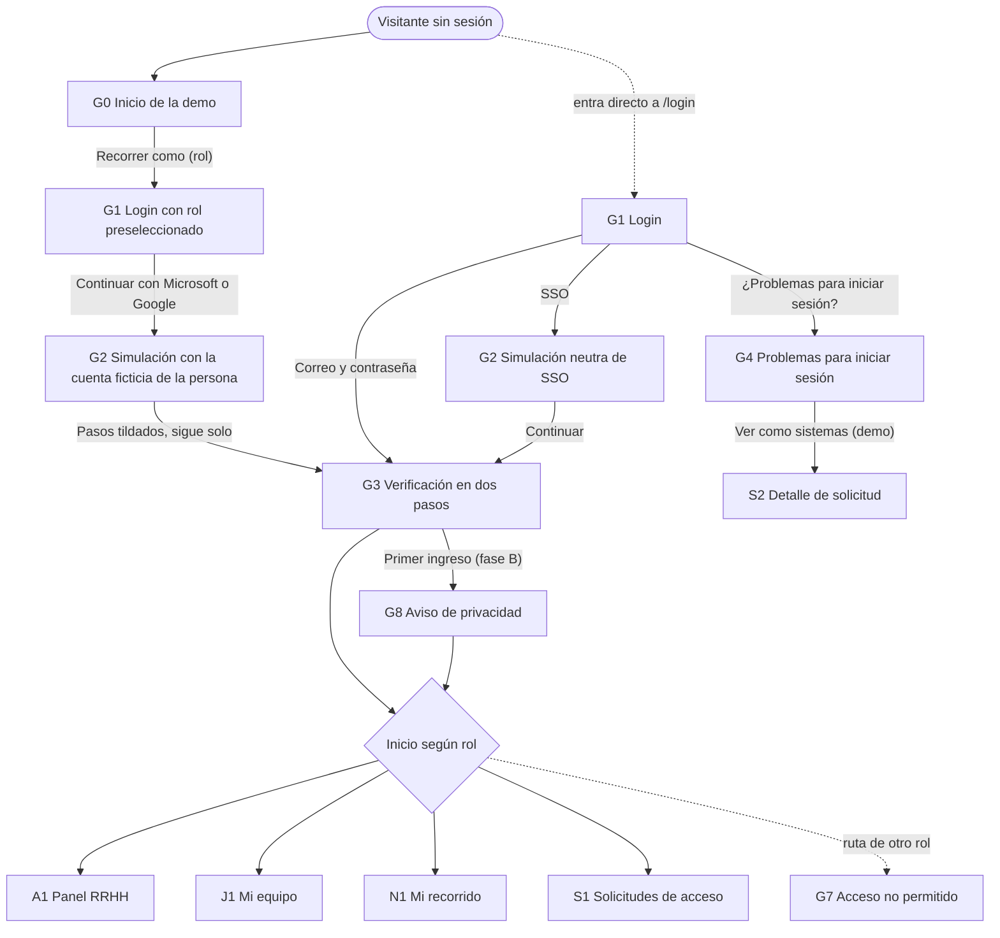

Muestra el camino desde el inicio de la demo (G0) hasta el inicio de cada rol. Elegir un recorrido abre el login con ese rol preseleccionado; "Continuar con Microsoft" o "Continuar con Google" abre la simulación neutra con la cuenta ficticia de esa persona, que tilda sus pasos y sigue sola a MFA con el código precargado (D-66). El formulario de correo llega con su correo de trabajo precargado. Quien entra directo a `/login` ve el login limpio. Una ruta ajena al rol termina en G7.

### 1.2 Layout común (G6)

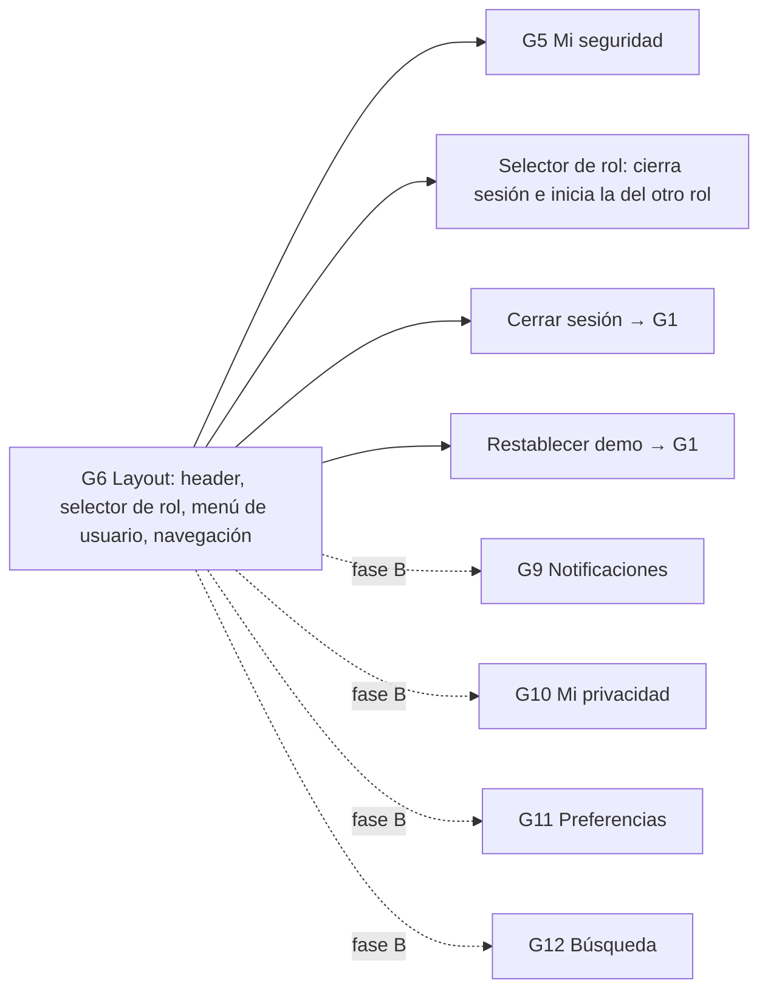

El layout está presente en todas las pantallas internas. Las líneas punteadas son pantallas de fase B.

### 1.3 Admin RRHH

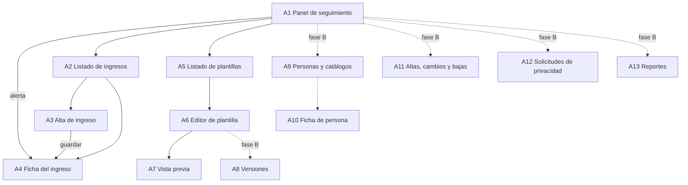

RRHH entra por el panel y desde ahí llega a ingresos y plantillas. Cada alerta lleva directo a la ficha del ingreso.

### 1.4 Jefe directo

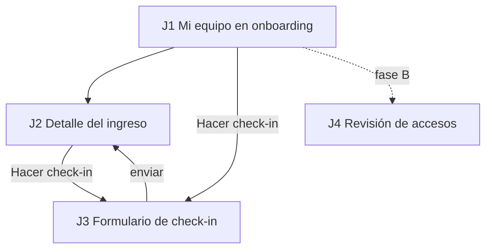

El jefe puede ir al check-in desde la lista del equipo o desde el detalle; al enviarlo vuelve al detalle con el historial actualizado.

### 1.5 Nuevo ingreso

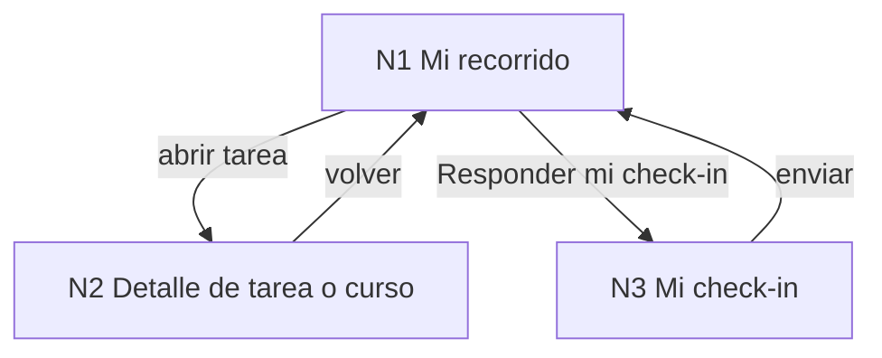

Todo parte de N1: desde ahí se abre cada tarea y se responde la autoevaluación.

### 1.6 Admin de sistemas

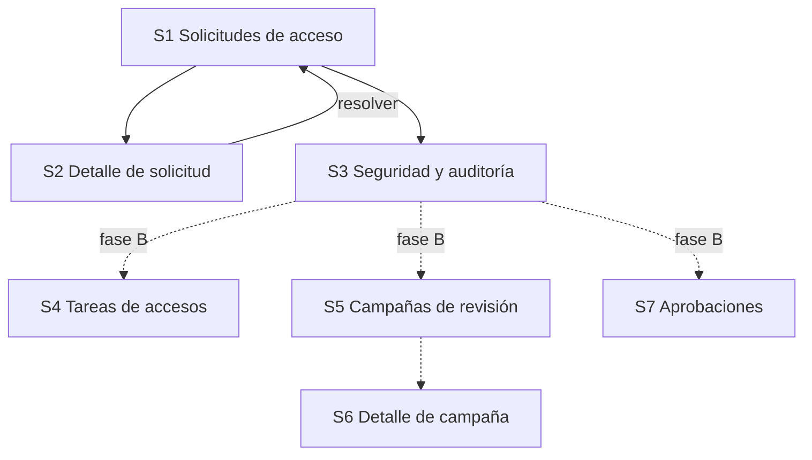

Sistemas trabaja desde su bandeja; S3 reúne usuarios bloqueados, auditoría, permisos y políticas en pestañas.

## 2. Diagrama de funciones y dependencias

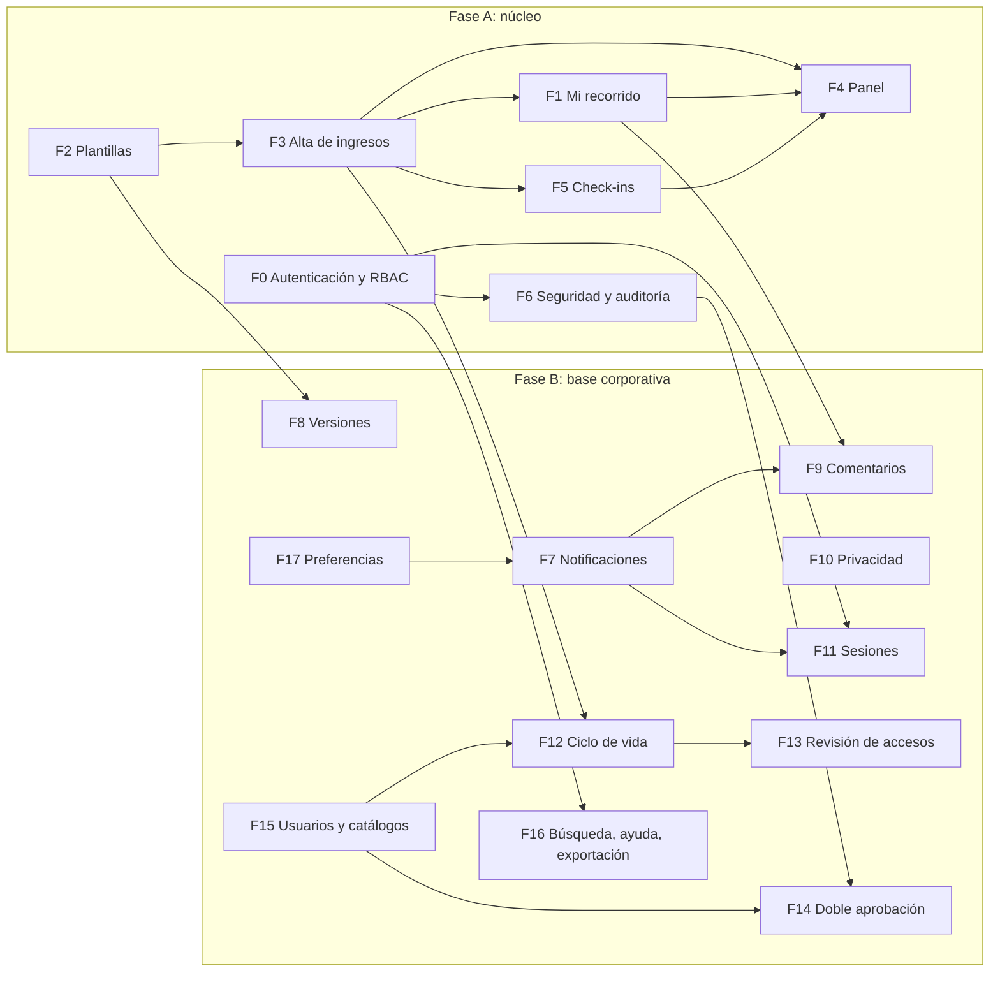

Una flecha de X a Y significa que Y necesita a X. Todo depende de F0 (sesión y permisos); por eso F0 se construye primero. F12 necesita el alta de ingresos (F3) y el catálogo de puestos (F15).

## 3. Task flows

> **Tipo: task flow.** Responde *¿qué pasos sigue la persona para completar una tarea?* Una sola línea, sin decisiones: es el camino ideal. Las alternativas y los errores están en los user flows (sección 4) y en los casos de uso.

### 3.1 Común: entrar a la demo con un recorrido

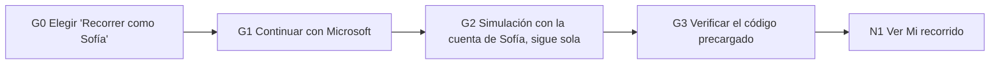

El camino del visitante del portfolio: elegir el recorrido y confirmar tres veces, sin escribir nada.

### 3.2 Común: solicitar ayuda a sistemas

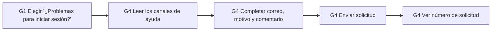

La persona deja su pedido sin recuperar el acceso por su cuenta.

### 3.3 Nuevo ingreso: completar una tarea

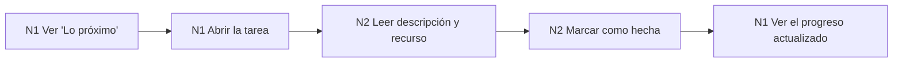

La tarea más frecuente del nuevo ingreso.

### 3.4 Nuevo ingreso: responder la autoevaluación

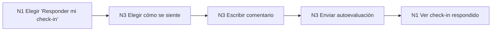

### 3.5 Jefe directo: hacer un check-in

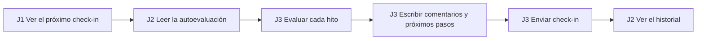

El camino sin hitos incumplidos; el escalamiento está en el user flow 4.3.

### 3.6 RRHH: crear una plantilla

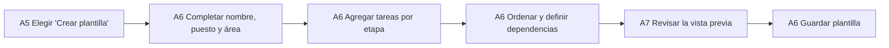

### 3.7 RRHH: dar de alta un ingreso

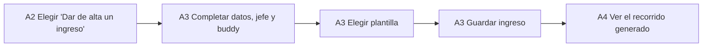

### 3.8 RRHH: atender una alerta del panel

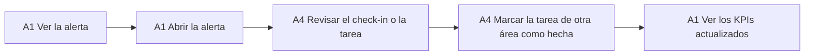

### 3.9 Sistemas: resolver una solicitud de acceso

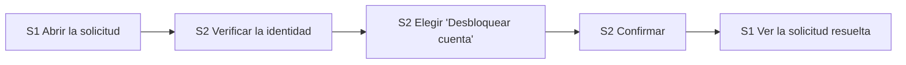

### 3.10 Sistemas: exportar la auditoría

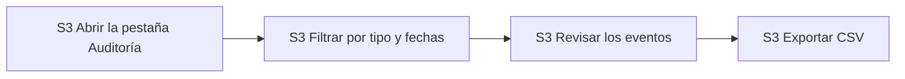

---

## 4. User flows

> **Tipo: user flow.** Responde *¿qué camino toma la persona según lo que decide o lo que pasa?* Incluye rombos de decisión y ramas.

### 4.1 Inicio de sesión y bloqueo

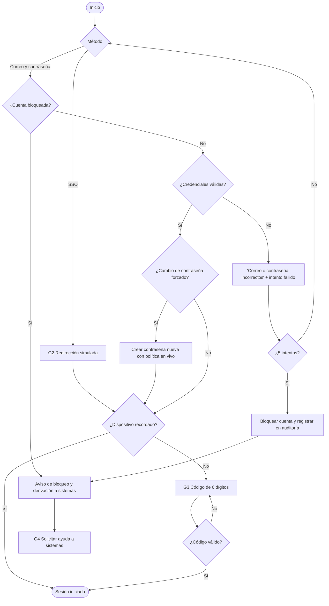

El bloqueo no se levanta solo: la única salida es una solicitud a sistemas. El error de credenciales es siempre el mismo, exista o no la cuenta.

### 4.2 Publicación de una plantilla

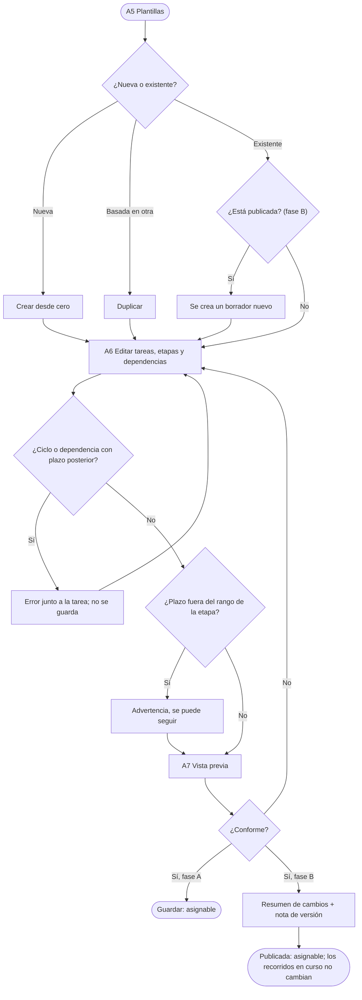

En fase A, guardar deja la plantilla lista para asignar. En fase B se suma la publicación con versiones: editar una publicada crea un borrador y publicar nunca cambia los recorridos en curso.

### 4.3 Check-in con escalamiento

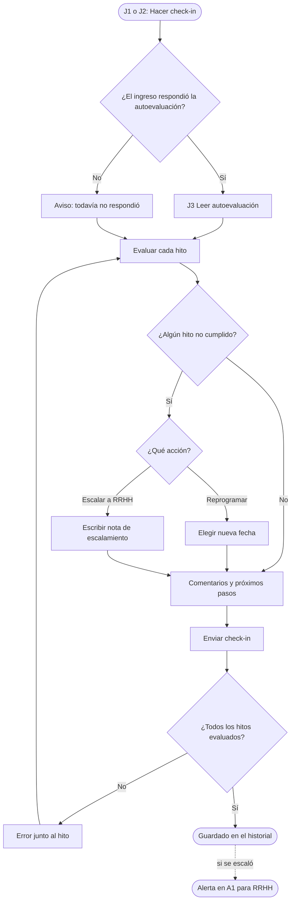

La autoevaluación es previa a la reunión pero no obligatoria. Solo el escalamiento genera una alerta para RRHH.

### 4.4 Solicitud de acceso

```mermaid
flowchart TD
    U(["Usuario sin acceso"]) --> G4["G4 Enviar solicitud"]
    G4 --> EX{"¿El correo existe?"}
    EX -- "Sí" --> REQ["Solicitud nueva en S1"]
    EX -- "No" --> NOREQ["Sin solicitud asociada a una cuenta"]
    REQ --> CONF["Confirmación con número, idéntica en ambos casos"]
    NOREQ --> CONF
    REQ --> S2["S2 Sistemas abre la solicitud"]
    S2 --> ID{"¿Se pudo verificar la identidad?"}
    ID -- "No" --> REJ(["Rechazar con motivo"])
    ID -- "Sí" --> ACT{"¿Qué necesita?"}
    ACT -- "Cuenta bloqueada" --> UN["Desbloquear"]
    ACT -- "Olvidó la contraseña" --> PW["Forzar cambio de contraseña"]
    ACT -- "No recibe el código" --> MF["Restablecer MFA"]
    UN --> AUD
    PW --> AUD
    MF --> AUD
    AUD["Registrar en auditoría"] --> BACK(["El usuario vuelve a iniciar sesión"])
```

La confirmación nunca revela si el correo existe. No hay forma de resolver sin verificar antes la identidad.

### 4.5 Baja de accesos (fase B)

```mermaid
flowchart TD
    R["A11 RRHH registra la baja con fecha y tipo"] --> CK["Checklist de revocación para sistemas"]
    R --> REM["Recordatorio al jefe directo"]
    CK --> IT["S4 Sistemas revoca cuenta, correo, herramientas y dispositivos"]
    IT --> D{"¿Llegó la fecha efectiva?"}
    D -- "No" --> IT
    D -- "Sí" --> P{"¿Quedan accesos sin revocar?"}
    P -- "Sí" --> LATE["Marcar como atrasada y notificar a sistemas"] --> OFF
    P -- "No" --> OFF["Cuenta deshabilitada y sesiones cerradas"]
    OFF --> AUD(["Todo queda en la auditoría"])
```

A la fecha efectiva la cuenta se deshabilita aunque falten tareas, que quedan marcadas como atrasadas.

---

## 5. Flujo de proceso: recorrido de un ingreso

> **Tipo: flujo de proceso.** Muestra cómo avanza el recorrido en el tiempo, no lo que hace una persona en la interfaz.

```mermaid
flowchart LR
    ALTA["Alta (A3)"] --> GEN["Generar tareas con fechas reales"]
    GEN --> PRE["Preingreso: antes del día 0"]
    PRE --> W1["Semana 1: días 0 a 6"]
    W1 --> M1["Mes 1: días 7 a 29"]
    M1 --> CI30["Check-in 30 días"]
    CI30 --> D90["Días 30 a 90"]
    D90 --> CI60["Check-in 60 días"]
    CI60 --> CI90["Check-in 90 días"]
    CI90 --> FIN(["Recorrido finalizado"])
```

Las etapas se derivan de la fecha de ingreso (límites de la sección 7 de `CLAUDE.md`). El recorrido se da por finalizado al completarse el check-in de 90 días.

---

## 6. Wireflows

> **Tipo: wireflow.** Responde *¿qué ve la persona en cada pantalla y qué toca para avanzar?* Cada wireflow une las capturas reales de `docs/screenshots/` con la acción que lleva a la pantalla siguiente (D-15, D-100). Se regeneran con `npm run og` desde la página interna `/wireflows`.

### 6.1 Inicio de sesión con MFA

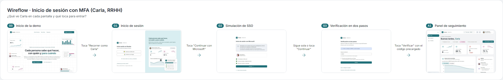

Carla entra desde la portada con su rol preseleccionado: en tres toques llega a su panel, pasando por la simulación de SSO rotulada y la verificación en dos pasos con el código precargado.

### 6.2 Recorrido del nuevo ingreso

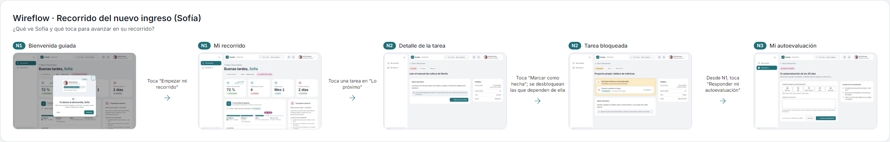

Sofía arranca con la bienvenida guiada, completa una tarea desde "Lo próximo" (lo que desbloquea las que dependen de ella), entiende por qué otra está bloqueada y responde su autoevaluación antes del check-in.

### 6.3 Crear y guardar una plantilla

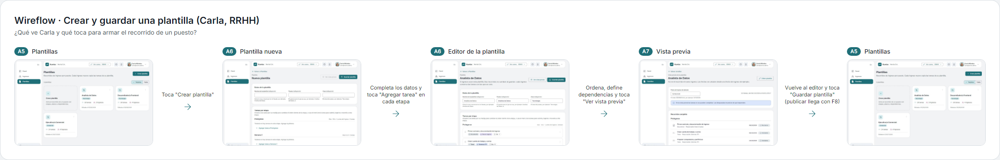

Carla crea una plantilla, agrega y ordena tareas con sus dependencias, la revisa como la verá el nuevo ingreso y la guarda. La publicación con versiones llega con F8 (fase B).

---

## 7. Diagramas de estados

### 7.1 Tarea del recorrido

```mermaid
stateDiagram-v2
    [*] --> blocked: tiene dependencias sin completar
    [*] --> pending: sin dependencias pendientes
    blocked --> pending: se completan sus dependencias
    pending --> in_progress: se abre el curso o la tarea
    pending --> done: se marca como hecha
    in_progress --> done: se marca como hecha
    pending --> overdue: vence la fecha
    in_progress --> overdue: vence la fecha
    overdue --> done: se marca como hecha
    done --> [*]
```

`blocked` y `overdue` se calculan, no se guardan: dependen de las dependencias y de `DEMO_TODAY`. Una tarea bloqueada y vencida se muestra como bloqueada, con la fecha vencida indicada.

### 7.2 Check-in

```mermaid
stateDiagram-v2
    [*] --> pending: se crea con el alta
    pending --> hire_done: el ingreso responde la autoevaluación
    pending --> completed: el jefe completa sin autoevaluación
    hire_done --> completed: el jefe completa el check-in
    completed --> [*]
    note right of completed
        Si hay un hito no cumplido,
        se reprograma o se escala a RRHH
    end note
```

El check-in tiene tres estados; la acción ante un hito no cumplido (reprogramar o escalar) se guarda dentro del check-in completado.

### 7.3 Versión de plantilla (fase B)

```mermaid
stateDiagram-v2
    [*] --> draft: crear, editar una publicada o restaurar
    draft --> published: publicar con nota
    published --> archived: se publica una versión más nueva
    draft --> [*]: descartar borrador
```

Solo hay una versión publicada vigente por plantilla. Las archivadas siguen asociadas a los ingresos que las usan.

### 7.4 Solicitud de acceso

```mermaid
stateDiagram-v2
    [*] --> new: el usuario la envía
    new --> verifying: sistemas marca la verificación
    verifying --> resolved: desbloquear, forzar cambio o restablecer MFA
    new --> rejected: rechazo con motivo
    verifying --> rejected: rechazo con motivo
    resolved --> [*]
    rejected --> [*]
```

No hay camino de `new` a `resolved` sin pasar por la verificación de identidad.

### 7.5 Solicitud de privacidad (fase B)

```mermaid
stateDiagram-v2
    [*] --> new: el usuario la envía
    new --> in_progress: RRHH la toma
    in_progress --> answered: RRHH responde
    new --> rejected: rechazo con motivo
    in_progress --> rejected: rechazo con motivo
    answered --> [*]
    rejected --> [*]
```

El plazo de respuesta corre desde `new` y es visible en todos los estados abiertos.

### 7.6 Campaña de revisión de accesos (fase B)

```mermaid
stateDiagram-v2
    [*] --> open: sistemas la crea con alcance y fecha límite
    open --> open: los jefes deciden mantener o revocar
    open --> closed: sistemas ejecuta revocaciones y cierra
    closed --> [*]
```

La campaña sigue abierta mientras los jefes revisan; al cerrarse se genera el resumen descargable.
