# Arquitectura de la información

> Estado: **borrador para revisión**, 10/11/2026. La organización y los rótulos son hipótesis de diseño; se validan con card sorting y test de árbol (sección 9).

La arquitectura de la información de Rumbo se describe con los cuatro sistemas clásicos: organización, rotulado, navegación y búsqueda (Rosenfeld et al., 2015). Complementa al [mapa de pantallas de flows.md](flows.md), que muestra cómo se navega entre pantallas. Este documento muestra cómo se agrupa y se nombra el contenido.

## 1. Inventario de contenidos

Qué objetos existen, sus atributos principales y quién los crea (C), edita (E) o consulta (V). Las abreviaturas de rol son RRHH, JEFE, NI (nuevo ingreso) e IT (sistemas).

| Objeto | Atributos principales | Crea | Edita | Consulta | Fase |
| --- | --- | --- | --- | --- | --- |
| Persona | Nombre, puesto, área, correo, rol, jefe directo, estado | RRHH (semilla en A) | RRHH | Todos (según permisos) | A (gestión en B) |
| Plantilla | Nombre, puesto, área, tareas, cantidad de usos, fecha de actualización | RRHH | RRHH | RRHH | A |
| Tarea de plantilla | Título, descripción, tipo, responsable, etapa, plazo relativo, dependencias, recurso | RRHH | RRHH | RRHH | A |
| Versión de plantilla | Número, estado, nota, autor, fecha, tareas | RRHH | RRHH (borrador) | RRHH | B |
| Ingreso | Persona, fecha de ingreso, jefe, buddy, referente de RRHH, plantilla, estado | RRHH | RRHH | RRHH, JEFE (su equipo), NI (propio) | A |
| Recorrido | Conjunto de tareas del ingreso agrupadas por etapa, con progreso | Sistema (al dar de alta) | | RRHH, JEFE, NI | A |
| Tarea del recorrido | Título, tipo, responsable, fecha límite, estado, dependencias | Sistema | RRHH, JEFE y NI (marcar las suyas como hechas) | RRHH, JEFE, NI | A |
| Check-in | Etapa (30, 60, 90), fecha, hitos, autoevaluación, comentarios, acción | Sistema | NI (autoevaluación), JEFE (evaluación) | RRHH, JEFE, NI (el propio) | A |
| Alerta | Tipo, ingreso, motivo, fecha | Sistema (calculada) | | RRHH | A |
| Solicitud de acceso | Número, correo, motivo, comentario, estado, verificación, resolución | Usuario sin sesión | IT | IT | A |
| Evento de auditoría | Fecha y hora, usuario, acción, recurso, resultado, detalle | Sistema | Nadie (inmutable) | IT | A |
| Política de seguridad | MFA por rol, duración de sesión, intentos antes del bloqueo, política de contraseñas | Semilla | IT con doble aprobación (B) | IT | A |
| Notificación | Tipo, título, texto, enlace, canales, leída | Sistema | Destinatario (marcar leída) | Destinatario | B |
| Comentario | Tarea, autor, texto, menciones, editado | RRHH, JEFE, NI | Autor | Participantes del recorrido | B |
| Aviso de privacidad y consentimiento | Versión, texto, fecha de aceptación | Semilla | | Todos | B |
| Solicitud de privacidad | Tipo, detalle, plazo, estado, respuesta | Cualquier usuario | RRHH | Solicitante, RRHH | B |
| Sesión de dispositivo | Dispositivo, navegador, ubicación aproximada, último uso | Sistema | Titular e IT (cerrar) | Titular, IT | B |
| Evento de ciclo de vida | Tipo (alta, cambio, baja), fecha efectiva, tareas de accesos | RRHH | IT (marcar accesos) | RRHH, IT | B |
| Campaña de revisión | Nombre, alcance, fecha límite, ítems, avance | IT | JEFE (decisiones), IT | IT, JEFE (su equipo) | B |
| Solicitud de aprobación | Acción, objetivo, motivo, solicitante, estado | RRHH o IT | Otra persona de IT | IT | B |
| Área y puesto | Nombre, área, plantilla sugerida, accesos sugeridos | RRHH | RRHH | RRHH | B |
| Preferencias | Idioma, zona horaria, formato de fecha, notificaciones, accesibilidad | Sistema (por defecto) | Titular | Titular | B |

## 2. Sistema de organización

Cómo se agrupa el contenido y por qué.

| Esquema | Dónde se aplica | Por qué |
| --- | --- | --- |
| **Por rol** (esquema de audiencia) | Nivel más alto: cada rol tiene su propio espacio (`/admin`, `/manager`, `/me`, `/it`) y su propia navegación. | Cada rol tiene objetivos distintos y ve datos distintos (mínimo privilegio). Mostrar solo lo propio reduce la carga cognitiva. |
| **Por tarea** (esquema de tareas) | Secciones dentro de cada rol: "Ingresos", "Plantillas", "Solicitudes", "Seguridad". | Las personas llegan con una tarea en mente ("dar de alta a alguien", "resolver un bloqueo"), no con un tipo de objeto. |
| **Por etapa del recorrido** (esquema cronológico) | N1, J2, A4, A6 y A7: tareas agrupadas en Preingreso, Semana 1, Mes 1 y Días 30 a 90. | El recorrido de ingreso es un proceso en el tiempo; la persona nueva piensa en "qué me toca ahora". |
| **Por estado** | Listados (A2, S1), alertas (A1), filtros de tareas. | Ayuda a priorizar: lo vencido o nuevo primero. |
| **Por urgencia** | "Lo próximo" en N1 y "Próximo check-in" en J1. | Responde de inmediato a la pregunta principal de cada rol. |

**Estructura:** jerárquica de poca profundidad (máximo 3 niveles: sección, listado, detalle), con enlaces contextuales que cruzan la jerarquía (alertas y notificaciones que llevan directo al detalle).

## 3. Sistema de rotulado

Los rótulos siguen el vocabulario fijo de la sección 2.9 de `CLAUDE.md`. Los términos técnicos (por ejemplo, "auditoría" o "MFA") se reservan para las pantallas de sistemas.

### 3.1 Navegación global por rol

| Rol | Ítems del menú lateral (en orden) |
| --- | --- |
| RRHH | Panel · Ingresos · Plantillas · *Personas (B)* · *Ciclo de vida (B)* · *Solicitudes de privacidad (B)* · *Reportes (B)* |
| Jefe directo | Mi equipo · *Revisión de accesos (B)* |
| Nuevo ingreso | Mi recorrido · Mi check-in |
| Sistemas | Solicitudes de acceso · Seguridad y auditoría · *Tareas de accesos (B)* · *Revisiones de accesos (B)* · *Aprobaciones (B)* |
| Todos (menú de usuario) | Mi seguridad · *Mi privacidad (B)* · *Preferencias (B)* · Restablecer demo · Cerrar sesión |

### 3.2 Glosario de términos

| Término en la interfaz | Definición | Evitar |
| --- | --- | --- |
| Recorrido de ingreso | Conjunto de tareas que una persona nueva completa desde antes de su ingreso hasta el día 90. | Onboarding (para el nuevo ingreso), plan |
| Nuevo ingreso / persona nueva | Quien se incorpora a la empresa y tiene un recorrido asignado. | Empleado nuevo, newbie |
| Jefe directo | Líder a cargo de la persona nueva; hace los check-ins. | Manager, supervisor |
| Buddy | Compañero o compañera que acompaña a la persona nueva en lo cotidiano. | Mentor (es otro rol) |
| Plantilla | Modelo de recorrido por puesto, con tareas y plazos relativos. | Template |
| Tarea | Acción del recorrido con responsable y fecha límite. Puede ser tarea, curso, reunión, lectura o documento. | Ítem, to-do |
| Etapa | Agrupación temporal de tareas: Preingreso, Semana 1, Mes 1, Días 30 a 90. | Fase (se reserva para el proyecto) |
| Plazo | Días respecto de la fecha de ingreso; negativo si es antes. | Offset |
| Dependencia | Tarea que tiene que estar hecha antes de poder hacer otra. | Requisito previo |
| Check-in | Conversación de seguimiento del jefe a los 30, 60 y 90 días. | Evaluación de desempeño |
| Hito | Logro esperado para una etapa, evaluado en el check-in como cumplido, parcial o no cumplido. | Objetivo, KPI |
| Autoevaluación | Respuesta de la persona nueva antes del check-in: cómo se siente y un comentario. | Encuesta |
| Escalar a RRHH | Pedir intervención de RRHH ante un hito no cumplido. | Reportar, denunciar |
| Panel | Pantalla de resumen con indicadores. | Dashboard |
| Alerta | Aviso calculado de un recorrido en riesgo. | Notificación (es otra cosa) |
| Notificación | Mensaje personal sobre un evento que requiere atención (fase B). | Alerta |
| Solicitud de acceso | Pedido de ayuda a sistemas para recuperar el acceso. | Ticket (en textos para el usuario) |
| Verificación en dos pasos | Código adicional a la contraseña. En pantallas de sistemas: MFA. | 2FA, token |
| Auditoría | Registro de eventos de seguridad y cambios. | Logs |

### 3.3 Estados

| Objeto | Estados (rótulo en la interfaz) | Color de estado |
| --- | --- | --- |
| Tarea | Pendiente · En curso · Hecha · Bloqueada · Vencida | neutro · `info` · `success` · `warning` · `error` |
| Check-in | Pendiente · Autoevaluación lista · Completado | `warning` · `info` · `success` |
| Ingreso | Próximo a ingresar · En curso · Finalizado | `info` · `primary` · `success` |
| Solicitud de acceso | Nueva · En verificación · Resuelta · Rechazada | `info` · `warning` · `success` · `error` |
| Plantilla (B) | Borrador · Publicada | neutro · `success` |

Todos los estados se muestran como píldora con ícono y texto, nunca solo con color.

## 4. Sistema de navegación

| Tipo | Cómo se resuelve |
| --- | --- |
| **Global** | Menú lateral por rol (3.1). Desktop: sidebar completa. Tablet: sidebar de íconos con tooltip. Mobile: menú inferior con hasta 4 ítems, o menú desplegable si hay más. El ítem activo usa ícono relleno. |
| **Utilitaria** | Header fijo: selector "Ver como" (demo), búsqueda (B), notificaciones (campana con contador de no leídas: panel desde 640 px y, en celulares, enlace directo a G9; D-105), ayuda y menú de usuario. Siempre en el mismo lugar (WCAG 3.2.6). |
| **Local** | Pestañas dentro de una sección: S3 (Usuarios bloqueados, Auditoría, Permisos, Políticas, Sesiones), A4 (Datos, Recorrido, Check-ins), A9 (Personas, Áreas, Puestos). Filtros como chips o botones segmentados. |
| **Contextual** | Alertas de A1 → ficha del ingreso. Notificaciones → lugar de la acción. "Lo próximo" → detalle de tarea. Motivo de bloqueo de una tarea → tarea que la bloquea. |
| **Migas de pan** | En pantallas de detalle y de segundo nivel: "Ingresos / Sofía Ramírez", "Plantillas / Analista de Datos / Vista previa", "Mi equipo / Sofía Ramírez / Check-in de 30 días". En mobile se reducen al nivel anterior ("‹ Ingresos"). |
| **Ayuda** | Ícono de ayuda contextual por pantalla (B) y, en el login, "¿Problemas para iniciar sesión?" siempre debajo del formulario. Reservado el lugar del botón de ayuda flotante (línea futura). |
| **Salto** | "Saltar al contenido" como primer elemento enfocable de cada página. "Volver arriba" en la esquina inferior derecha de las páginas largas, visible solo después de desplazarse (D-104). |
| **Índice de página** | En el sitio del sistema de diseño: índice lateral fijo desde 1280 px y, por debajo, barra fija "Secciones \| sección actual" que abre el índice en un panel (D-104). |

## 5. Sistema de búsqueda (fase B, F16)

| Aspecto | Definición |
| --- | --- |
| Acceso | Campo en el header; atajo `Ctrl+K` o `/`. Página de resultados G12. |
| Qué se busca | Personas, plantillas, tareas y solicitudes, filtrado por los permisos del rol (`search:global` más el permiso de ver cada tipo). |
| Por rol | RRHH: personas, ingresos, plantillas, tareas, solicitudes de privacidad. Jefe: personas de su equipo y sus tareas. Nuevo ingreso: sus propias tareas y contactos. Sistemas: personas (datos de identificación), solicitudes de acceso, eventos de auditoría. |
| Resultados | Agrupados por tipo, con hasta 5 por grupo en la búsqueda rápida y "Ver todos" hacia G12. Cada resultado muestra título, tipo y un dato de contexto (área, estado o fecha). |
| Filtros en G12 | Tipo, área y estado. |
| Sin resultados | Explica qué se puede buscar y sugiere revisar la escritura o quitar filtros. |
| Fase A | No hay búsqueda global; los listados (A2, A5, S1, auditoría) tienen búsqueda y filtros propios. |

## 6. Mapa del sitio por rol

```mermaid
flowchart TD
    ROOT["Rumbo"] --> G0["G0 Inicio de la demo"]
    ROOT --> ACC["Acceso"]
    ACC --> G1["G1 Login"]
    G1 --> G2["G2 Simulación de SSO"]
    G1 --> G3["G3 Verificación en dos pasos"]
    G1 --> G4["G4 Problemas para iniciar sesión"]

    ROOT --> RRHH["RRHH"]
    RRHH --> A1["A1 Panel"]
    RRHH --> ING["Ingresos"]
    ING --> A2["A2 Listado"]
    ING --> A3["A3 Alta"]
    ING --> A4["A4 Ficha"]
    RRHH --> PLA["Plantillas"]
    PLA --> A5["A5 Listado"]
    PLA --> A6["A6 Editor"]
    A6 --> A7["A7 Vista previa"]
    A6 -.-> A8["A8 Versiones"]
    RRHH -.-> A9["A9 Personas"]
    A9 -.-> A10["A10 Ficha de persona"]
    RRHH -.-> A11["A11 Ciclo de vida (B)"]
    RRHH -.-> A12["A12 Solicitudes de privacidad"]
    RRHH -.-> A13["A13 Reportes (B)"]

    ROOT --> JEFE["Jefe directo"]
    JEFE --> J1["J1 Mi equipo"]
    J1 --> J2["J2 Detalle del ingreso"]
    J2 --> J3["J3 Check-in"]
    JEFE -.-> J4["J4 Revisión de accesos (B)"]

    ROOT --> NI["Nuevo ingreso"]
    NI --> N1["N1 Mi recorrido"]
    N1 --> N2["N2 Detalle de tarea"]
    NI --> N3["N3 Mi check-in"]

    ROOT --> IT["Sistemas"]
    IT --> SOL["Solicitudes de acceso"]
    SOL --> S1["S1 Bandeja"]
    S1 --> S2["S2 Detalle"]
    IT --> S3["S3 Seguridad y auditoría"]
    IT -.-> S4["S4 Tareas de accesos (B)"]
    IT -.-> S5["S5 Revisiones (B)"]
    S5 -.-> S6["S6 Detalle de campaña (B)"]
    IT -.-> S7["S7 Aprobaciones (B)"]

    ROOT --> CUENTA["Cuenta (todos)"]
    CUENTA --> G5["G5 Mi seguridad"]
    CUENTA -.-> G9["G9 Notificaciones"]
    CUENTA -.-> G10["G10 Mi privacidad"]
    CUENTA -.-> G11["G11 Preferencias (B)"]
    CUENTA -.-> G12["G12 Búsqueda (B)"]
    ROOT --> G7["G7 Acceso no permitido / 404"]
```

Jerarquía de secciones y pantallas que ve cada rol. Las líneas punteadas son de fase B. G6 (layout) y G8 (aviso de privacidad) no aparecen porque no son destinos de navegación: G6 envuelve todas las pantallas internas y G8 se muestra una sola vez al primer ingreso.

## 7. Plantillas de página

Cinco tipos de pantalla con zonas fijas. Todas comparten el layout G6 (header, menú lateral y área de contenido con un único `h1`).

| Plantilla | Pantallas | Zonas, de arriba hacia abajo |
| --- | --- | --- |
| **Panel bento** | A1, J1, N1, S3 (resumen), A13 | 1. Saludo o título y acción principal. 2. Fila de KPIs (`BentoCard sm`). 3. Gráfico o bloque principal (`lg`/`wide`). 4. Bloques secundarios y alertas (`md`/`tall`). En mobile, una columna ordenada por prioridad. |
| **Listado con filtros** | A2, A5, S1, A9, A12, S4, S5, S7, G9 | 1. Título, contador y acción principal ("Dar de alta un ingreso"). 2. Búsqueda y filtros en chips. 3. Tabla con estados en píldoras (tarjetas en mobile). 4. Paginación o "Cargar más". Estado vacío guiado. |
| **Ficha de detalle** | A4, J2, N2, S2, A10, S6 | 1. Migas de pan. 2. Encabezado con nombre, estado y acciones. 3. Pestañas o secciones (datos, recorrido, historial). 4. Panel lateral con contactos o metadatos (debajo en mobile). |
| **Formulario** | A3, A6 (tarea), J3, N3, G4, G11 | 1. Título y explicación breve. 2. Resumen de errores (solo si hay). 3. Grupos de campos con etiqueta y texto de ayuda. 4. Barra de acciones: principal a la derecha, cancelar a la izquierda (apiladas en mobile, principal arriba). |
| **Flujo por pasos** | G1 a G4, G8, recorrido guiado (B) | 1. Logo y contexto. 2. Indicador de pasos (puntos). 3. Contenido del paso. 4. Anterior / Continuar. En el login: dos columnas en desktop (formulario y vista previa del producto), una en mobile. |

## 8. Coherencia con otros documentos

- Las pantallas y sus IDs coinciden con `CLAUDE.md` (sección 6) y con el mapa de pantallas de [flows.md](flows.md).
- Los permisos que limitan qué ve cada rol están en [roles.md](roles.md).
- Los rótulos de estados y botones se trasladan a `src/locales/es.json` en el paso 1.

## 9. Plan de validación

| Método | Objetivo | Participantes | Material | Criterio de éxito |
| --- | --- | --- | --- | --- |
| **Card sorting abierto** | Validar cómo agrupan y nombran el contenido las personas de cada rol. | 5 a 8 por rol de RRHH y sistemas; 5 jefes; 5 ingresos recientes | 30 a 40 tarjetas con los objetos y acciones del inventario (sección 1) | Las agrupaciones coinciden en al menos el 60 % con la organización propuesta; los rótulos con más divergencia se revisan. |
| **Test de árbol** (tree testing) | Validar que se encuentra cada función en la navegación propuesta, sin diseño visual. | 15 a 20 participantes en total | Árbol de la sección 6 y 8 a 10 tareas, por ejemplo: "¿Dónde verías por qué una tarea está bloqueada?" | Tasa de éxito ≥ 80 % por tarea y directitud ≥ 70 %. |

## Resultados de la validación

*Sección pendiente. Se completa después del card sorting y del test de árbol.*

## Referencias

Rosenfeld, L., Morville, P., & Arango, J. (2015). *Information architecture: For the web and beyond* (4th ed.). O'Reilly Media.

World Wide Web Consortium. (2023). *Web Content Accessibility Guidelines (WCAG) 2.2*. https://www.w3.org/TR/WCAG22/
