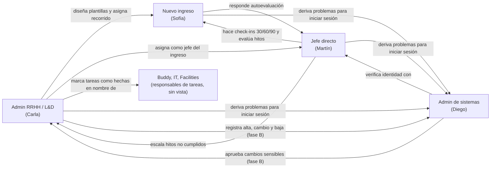

# Organización de roles

El MVP tiene cuatro roles navegables. Las áreas IT, Facilities y buddy aparecen como **responsables de tareas** del recorrido, pero no tienen vista propia para gestionarlas (sección 4 de `CLAUDE.md`).

| Rol | Clave en el código | Persona demo | Inicio |
| --- | --- | --- | --- |
| Admin RRHH / L&D | `admin` | Carla Méndez | `/admin` |
| Jefe directo | `manager` | Martín Rossi | `/manager` |
| Nuevo ingreso | `hire` | Sofía Ramírez | `/me` |
| Admin de sistemas | `it_admin` | Diego Ferreyra | `/it/requests` |

## 1. Relaciones entre roles

El diagrama muestra quién asigna, evalúa, escala o deriva a quién. Todos los roles derivan sus problemas de acceso a sistemas, porque no hay autogestión; sistemas puede apoyarse en el jefe directo para verificar la identidad.

## 2. Matriz de permisos (rol × acción)

> **Generada desde `src/lib/permissions.ts`** (`permissionMatrixMarkdown()`). Un test (`permissions-doc.test.ts`) falla si esta tabla y el código no coinciden. Rutas, navegación y botones consultan siempre `can(user, 'acción')`, nunca el nombre del rol.

Leyenda: ✅ todo · 👥 solo su equipo · 🙋 solo lo propio · — no permitido.

### Fase A (implementada)

<!-- permissions:start -->
| Acción | Descripción | RRHH | Jefe | Nuevo ingreso | Sistemas |
| --- | --- | :-: | :-: | :-: | :-: |
| `workspace:hr` | Sección de RRHH (panel, ingresos, plantillas) | ✅ | — | — | — |
| `workspace:team` | Sección del jefe directo (mi equipo) | — | 👥 | — | — |
| `workspace:journey` | Sección del nuevo ingreso (mi recorrido) | — | — | 🙋 | — |
| `workspace:it` | Sección de sistemas (accesos, auditoría) | — | — | — | ✅ |
| `dashboard:view` | Ver el panel de seguimiento (A1) | ✅ | — | — | — |
| `template:view` | Ver plantillas y su vista previa | ✅ | — | — | — |
| `template:edit` | Crear, duplicar, editar y eliminar plantillas | ✅ | — | — | — |
| `hire:view` | Ver ingresos y su ficha | ✅ | 👥 | 🙋 | — |
| `hire:create` | Dar de alta un ingreso | ✅ | — | — | — |
| `task:complete` | Marcar una tarea como hecha | ✅ | 👥 | 🙋 | — |
| `checkin:fill` | Completar el check-in como jefe (J3) | — | 👥 | — | — |
| `checkin:self_review` | Responder la autoevaluación (N3) | — | — | 🙋 | — |
| `checkin:view_self_review` | Leer la autoevaluación del ingreso | ✅ | 👥 | 🙋 | — |
| `checkin:view_escalations` | Ver y atender check-ins escalados | ✅ | — | — | — |
| `access_request:view` | Ver la bandeja de solicitudes de acceso | — | — | — | ✅ |
| `access_request:resolve` | Verificar identidad y resolver solicitudes | — | — | — | ✅ |
| `account:unlock` | Desbloquear cuentas | — | — | — | ✅ |
| `audit:view` | Ver y filtrar la auditoría | — | — | — | ✅ |
| `audit:export` | Exportar la auditoría a CSV | — | — | — | ✅ |
| `security:view` | Ver políticas y matriz de permisos | — | — | — | ✅ |
| `comment:write` | Comentar en las tareas de los recorridos que ve (N2, J2, A4) | ✅ | 👥 | 🙋 | — |
| `privacy:own` | Ver "Mi privacidad" y pedir acceso, rectificación o supresión de sus datos (G10) | 🙋 | 🙋 | 🙋 | 🙋 |
| `privacy_request:manage` | Atender las solicitudes sobre datos personales (A12) | ✅ | — | — | — |
| `pii:reveal` | Revelar DNI, CUIL o datos bancarios con un motivo, que queda en la auditoría | ✅ | — | — | — |
| `session:manage` | Ver las sesiones activas de la organización y forzar su cierre (S3) | — | — | — | ✅ |
| `notification:view` | Ver sus propias notificaciones (G9) | 🙋 | 🙋 | 🙋 | 🙋 |
| `account:security_own` | Ver "Mi seguridad" (G5) | 🙋 | 🙋 | 🙋 | 🙋 |
| `demo:switch_role` | Usar el selector de rol de demo | ✅ | ✅ | ✅ | ✅ |
| `demo:reset` | Restablecer la demo | ✅ | ✅ | ✅ | ✅ |
<!-- permissions:end -->

Las secciones (`workspace:*`) definen a qué rutas entra cada rol: `/admin`, `/manager`, `/me` e `/it`. El inicio de cada rol también sale de la matriz (`homePath`).

### Fase B (propuesta, se implementa con cada función)

| Acción | Descripción | RRHH | Jefe | Nuevo ingreso | Sistemas |
| --- | --- | :-: | :-: | :-: | :-: |
| `notification:view` | Ver sus notificaciones | 🙋 | 🙋 | 🙋 | 🙋 |
| `template:publish` | Publicar versiones y restaurar | ✅ | — | — | — |
| `comment:create` | Comentar en tareas del recorrido | ✅ | 👥 | 🙋 | — |
| `privacy_request:create` | Enviar una solicitud sobre datos personales | 🙋 | 🙋 | 🙋 | 🙋 |
| `privacy_request:manage` | Gestionar la bandeja de solicitudes de privacidad | ✅ | — | — | — |
| `pii:reveal` | Revelar DNI, CUIL o datos bancarios (con motivo) | ✅ | — | — | — |
| `session:view_all` | Ver sesiones activas de toda la organización | — | — | — | ✅ |
| `session:force_logout` | Forzar el cierre de sesiones de una cuenta | — | — | — | ✅ |
| `people:manage` | Alta y edición de personas, áreas y puestos | ✅ | — | — | — |
| `role:request_change` | Pedir un cambio de rol a admin (doble aprobación) | ✅ | — | — | — |
| `lifecycle:register` | Registrar alta, cambio de puesto o baja | ✅ | — | — | — |
| `lifecycle:execute` | Otorgar o revocar accesos | — | — | — | ✅ |
| `access_review:manage` | Crear, seguir y cerrar campañas de revisión | — | — | — | ✅ |
| `access_review:decide` | Decidir mantener o revocar accesos de su equipo | — | 👥 | — | — |
| `approval:decide` | Aprobar o rechazar cambios sensibles (nunca los propios) | — | — | — | ✅ |
| `report:export` | Exportar reportes (respetando el enmascarado) | ✅ | — | — | ✅ (solo auditoría y campañas) |
| `search:global` | Búsqueda global filtrada por permisos | ✅ | ✅ | ✅ | ✅ |
| `preferences:edit_own` | Editar sus preferencias | 🙋 | 🙋 | 🙋 | 🙋 |

## 3. Qué datos ve cada rol (mínimo privilegio)

| Rol | Ve | No ve |
| --- | --- | --- |
| **RRHH** | Todos los ingresos, plantillas, check-ins (incluidas las autoevaluaciones), métricas y alertas. Datos de ánimo en forma individual en la ficha del ingreso. | Bandeja de accesos, auditoría, sesiones y políticas de seguridad (exclusivas de sistemas). DNI y CUIL completos sin revelarlos con motivo (fase B). |
| **Jefe directo** | Solo los ingresos de su equipo, su recorrido, sus check-ins y las autoevaluaciones de su equipo. | Ingresos de otros equipos, plantillas, panel general, datos de seguridad. |
| **Nuevo ingreso** | Su propio recorrido, sus tareas, sus contactos clave y sus propios check-ins. | Recorridos ajenos, evaluaciones del jefe antes de que el check-in se complete, métricas. |
| **Sistemas** | Solicitudes de acceso, cuentas bloqueadas, auditoría, sesiones, políticas, matriz de permisos. Datos de identificación necesarios para verificar identidad (nombre, correo, jefe directo). | Recorridos, check-ins, autoevaluaciones y datos de ánimo. |

**Reglas transversales**
- En el panel de RRHH (A1), los datos de ánimo se muestran **agregados**; el detalle individual solo en la ficha de cada ingreso.
- Todo acceso denegado se registra en la auditoría (`auth.access_denied`).
- Cambiar de rol con el selector de demo cierra la sesión actual e inicia la del usuario demo del otro rol; queda registrado.
