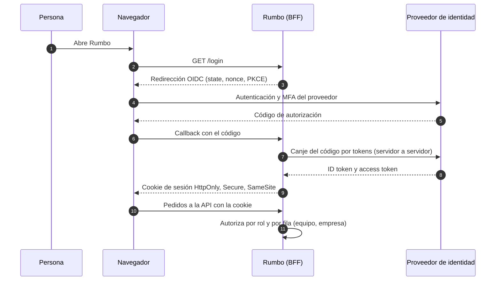

# Seguridad y privacidad

Rumbo es un **prototipo de portfolio**: corre por completo en el navegador, sin backend, con datos ficticios de una empresa inventada (Nortia S.A.). Por eso la seguridad se trabaja en tres capas (CLAUDE.md, sección 8):

1. **Simulada en la interfaz:** la experiencia completa de seguridad de una app corporativa, para mostrar que está diseñada. No protege nada de verdad.
2. **Aplicada de verdad en el front-end:** buenas prácticas reales que sí rigen en el sitio publicado.
3. **Arquitectura de producción:** cómo se implementaría en un producto real. Es la base para el case study.

Última revisión: 12/11/2026 (capa de borde, D-141).

---

## 1. Capa simulada: la experiencia de seguridad

Todo lo de esta sección ocurre en el cliente y se guarda en `localStorage`. Sirve para recorrer los flujos, no para proteger datos.

| Qué se simula | Dónde se ve | Cómo se comporta |
| --- | --- | --- |
| Inicio de sesión con SSO (Microsoft, Google) | G1, G2 | Pantalla neutra y rotulada como simulación; nunca imita la página real del proveedor, porque una copia funciona igual que una página de phishing |
| Correo y contraseña | G1 | Error genérico ("Correo o contraseña incorrectos") que no revela si el correo existe |
| Bloqueo por intentos | G1, S3 | 5 intentos fallidos bloquean la cuenta; no se desbloquea sola ni la desbloquea la persona |
| Verificación en dos pasos (MFA) | G3, G5 | Obligatoria para RRHH y sistemas; código en un solo campo que acepta pegar (WCAG 3.3.8) |
| Derivación a sistemas | G4, S1, S2 | Sin autogestión: la persona pide ayuda y sistemas **verifica la identidad** antes de restablecer el acceso |
| Verificación de identidad | S2 | Solo con datos de la ficha (celular registrado o jefe directo), nunca con los que trae la solicitud |
| Expiración por inactividad | Layout | Aviso en el minuto 13 con "Seguir conectado"; cierre en el 15 (WCAG 2.2.1) |
| Control de acceso por rol (RBAC) | Todas las rutas | Una sola matriz en `src/lib/permissions.ts`; rutas y botones consultan `can()`; el acceso denegado queda en la auditoría |
| Mínimo privilegio en los datos | A1, J1, J2 | El jefe ve solo a su equipo; el ánimo se muestra agregado y con 3 respuestas o más |
| Auditoría | S3 | Inicios y cierres de sesión, intentos, bloqueos, solicitudes, desbloqueos, cambios de contraseña, MFA, accesos denegados, altas, plantillas, check-ins escalados, exportaciones y restablecimiento de la demo |
| Políticas de la organización | S3 | MFA por rol, inactividad, intentos y requisitos de contraseña, en modo lectura |

---

## 2. Capa aplicada de verdad en el front-end

### 2.1 Política de seguridad de contenido (CSP)

El build publicado lleva esta política como `<meta http-equiv="Content-Security-Policy">`. La inyecta un plugin de Vite solo en producción (`vite.config.ts`), porque en desarrollo Vite necesita scripts en línea para la recarga en caliente.

```
default-src 'self';
script-src 'self';
style-src 'self' 'unsafe-inline';
img-src 'self' data:;
font-src 'self' data:;
connect-src 'self';
manifest-src 'self';
worker-src 'self';
object-src 'none';
base-uri 'self';
form-action 'self';
upgrade-insecure-requests
```

- **Ningún recurso externo:** la tipografía Inter está alojada en el proyecto (`@fontsource-variable/inter`), los íconos son SVG propios y los gráficos se dibujan en el cliente.
- **Scripts estrictos:** solo los del propio sitio. Sin `unsafe-inline` ni `unsafe-eval` en `script-src`, que es lo que frena un XSS.
- **Estilos en línea permitidos:** Radix (`react-remove-scroll`) y Motion insertan bloques `<style>` con valores calculados al abrir menús y diálogos, y Recharts mide las etiquetas con atributos `style`. Un hash no cubre valores que cambian, y un nonce fijo en un `<meta>` estático no protegería nada. Se verificó en el build (`vite preview`) que con esta política no hay violaciones al recorrer las pantallas ni al abrir menús y diálogos.
- **Limitación de GitHub Pages:** no permite enviar cabeceras HTTP, así que `frame-ancestors`, `X-Frame-Options` y HSTS no se pueden aplicar desde un `<meta>`. Quedan en la arquitectura de producción (sección 3.8).
- **Control en CI:** el workflow falla si `dist/index.html` sale sin la política.

### 2.2 Otras prácticas aplicadas

| Práctica | Cómo se cumple |
| --- | --- |
| Sin secretos ni datos reales | No hay claves de API ni tokens. Personas, empresa y correos (`.demo`) son ficticios. Las credenciales de demo (`Demo.2026!`, código `246810`) son públicas a propósito y se muestran en pantalla |
| Validación de entradas | Todo formulario valida con Zod antes de guardar (`src/lib/validation.ts`); máscaras de entrada para fechas, plazos, códigos y celulares |
| Sin HTML construido con datos | No se usa `dangerouslySetInnerHTML`; React escapa el texto. Los comentarios y notas se guardan como texto plano |
| Enlaces externos | `rel="noopener noreferrer"` en todos; `window.open` con `noopener,noreferrer` |
| Política de referrer | `strict-origin-when-cross-origin` en el build |
| Dependencias | Versiones fijas y `package-lock.json` versionado; `npm ci` en CI |
| Auditoría de dependencias | `npm audit --audit-level=high` en CI: el deploy falla con vulnerabilidades altas o críticas |
| Permisos del workflow | `contents: read` por defecto; `pages: write` e `id-token: write` solo en el job de deploy |
| Almacenamiento local | `localStorage` guarda solo datos de demo, la sesión simulada y preferencias de interfaz; nunca algo que simule una contraseña ni un token. Si los datos guardados no tienen la forma esperada, se reemplazan por los datos semilla |
| Datos enmascarados | El celular, el DNI y el CUIL (ficticios) se muestran enmascarados; RRHH puede mostrar uno escribiendo un motivo, que queda en la auditoría como `pii.reveal` (F10, D-113) |
| Sesiones y alertas | "Mi seguridad" lista los dispositivos con sesión abierta y permite cerrarlos; un inicio desde un dispositivo o lugar nuevo genera "¿Fuiste tú?", y "No fui yo" cierra esa sesión y abre una solicitud urgente para sistemas. Sistemas ve las sesiones de la organización y puede forzar su cierre (F11, D-114). Todo simulado: no hay tokens detrás |
| Aviso de privacidad | Nadie entra a la app sin aceptar la versión vigente del aviso (G8); la aceptación queda con fecha, versión y evento `privacy.consent` (F10, D-113) |

---

## 3. Arquitectura de producción

Cómo se construiría Rumbo como producto real, multiempresa, para clientes corporativos.

### 3.1 Identidad

- **Inicio de sesión federado** con OIDC (o SAML 2.0 para clientes que lo exijan) contra el proveedor de identidad de cada empresa cliente: Microsoft Entra ID o Google Workspace. Rumbo **no guarda contraseñas propias**.
- **MFA delegado al proveedor**, con acceso condicional (por ejemplo, exigir MFA resistente al phishing a los roles de RRHH y sistemas).
- **Aprovisionamiento con SCIM 2.0:** altas, cambios y bajas de personas llegan desde el proveedor; los grupos del proveedor se mapean a los roles de Rumbo.
- **Mesa de ayuda:** el bloqueo, el restablecimiento de contraseña y de MFA se hacen en el proveedor de identidad, por sistemas y siempre después de verificar la identidad con un canal registrado de antemano. La ingeniería social sobre la mesa de ayuda es una vía de ataque conocida, y por eso la verificación nunca usa datos que trae la propia solicitud.



*Diagrama de secuencia del inicio de sesión en producción: los tokens nunca llegan al navegador; el navegador solo tiene una cookie de sesión que el servidor valida en cada pedido.*

### 3.2 Sesión

- Patrón **BFF** (*backend for frontend*): los tokens viven en el servidor; el navegador recibe una cookie de sesión `HttpOnly`, `Secure`, `SameSite=Lax` (o `Strict`), nunca un token en `localStorage`.
- Sesiones cortas con renovación en el servidor; cierre por inactividad de 15 minutos con aviso, como en el prototipo.
- Protección CSRF con `SameSite` más un token de sincronización en los pedidos que cambian datos.
- Cierre remoto de sesiones (F11) y revocación inmediata al dar de baja una cuenta.

### 3.3 Autorización

- **RBAC verificado siempre en el servidor**, con la misma matriz que hoy vive en `permissions.ts` (el front solo la usa para mostrar u ocultar).
- **Seguridad por fila** (por ejemplo, *row-level security* de PostgreSQL): cada empresa cliente ve solo sus datos y cada jefe, solo a su equipo. La autoevaluación la ven solo el jefe directo y RRHH.
- Acciones sensibles con **doble aprobación** (F14): quien pide un cambio de rol de administrador o de una política de seguridad no puede aprobarlo, ni tampoco la persona a la que afecta. En la demo (D-118) la regla vive en `src/lib/approvals.ts`, los intentos bloqueados quedan en la auditoría como denegados y el cambio se aplica solo al aprobarse. En producción, la misma verificación se hace en el servidor y los cambios de política se aplican en el proveedor de identidad.
- **Separación de funciones:** en producción, la doble aprobación exige al menos **dos personas con el rol de sistemas**; con una sola, nadie podría aprobar lo que ella pide y el control quedaría anulado. La demo lo resuelve con una segunda persona de datos (Ramiro Sosa, sin cuenta de demo) y un atajo rotulado "Resolver como Ramiro (demo)" que la auditoría marca como decisión simulada; ese atajo no existe en producción.
- **Exportaciones** (F16, D-128): los listados salen siempre con DNI y CUIL ocultos. Una exportación con esos datos sin ocultar es un pedido de doble aprobación (`pii.export`): quien lo pide no lo aprueba, solo esa persona lo descarga y una sola vez. Cada descarga queda en la auditoría. En producción, el archivo se genera en el servidor, con vencimiento corto y marca de agua con quién lo descargó.
- **Control de separación de funciones: mínimo dos personas de sistemas** (D-121). Ningún cambio puede dejar a sistemas con menos de dos personas activas: ni quitar el rol (cambio de rol o revocación en una campaña) ni dar de baja. Se verifica al pedir el cambio y otra vez al aprobarlo, porque otra solicitud pudo aprobarse entre medio; si no se cumple, el cambio no se aplica y el intento queda en la auditoría con resultado `denied`. En producción, el mismo control vive en el servidor, dentro de la transacción que aplica el cambio, y se complementa con una cuenta de emergencia (*break-glass*) guardada fuera de la operación diaria.

### 3.4 Datos

- Cifrado en tránsito (TLS 1.2 o superior) y en reposo (claves gestionadas por un servicio de KMS).
- **Multiempresa con aislamiento lógico** por `tenant_id` en todas las tablas y en las políticas por fila; copias de seguridad cifradas y probadas.
- **Minimización:** solo los datos necesarios para el recorrido. La plataforma no guarda la cuenta bancaria: la usa liquidación de sueldos y ninguna tarea del onboarding la necesita (D-135). Los datos sensibles que sí guarda (DNI y CUIL, para la identificación y la registración laboral) van enmascarados y revelados solo con permiso, motivo y registro en la auditoría (F10).
- **Retención:** datos del recorrido 2 años después de finalizado y autoevaluaciones 1 año; luego se anonimizan.

### 3.5 Auditoría

- Registro **solo de agregado** (*append-only*), con almacenamiento inmutable (por ejemplo, retención WORM) y acceso restringido a sistemas y a auditoría interna.
- Cada evento con actor, acción, recurso, resultado, fecha y hora en UTC, dirección IP y agente; sincronizado con un SIEM.

### 3.6 Ciclo de vida de identidades

- Altas, cambios de puesto y bajas sincronizados entre el sistema de RRHH (HRIS), el proveedor de identidad y Rumbo.
- Revocación automática en la fecha de baja y revisiones periódicas de accesos por jefe (F12, F13).
- **Revisión de accesos** (F13, D-120): nadie revisa sus propios accesos (sin jefe directo revisa RRHH, y a RRHH la revisa sistemas), las cuentas admin entran en todas las campañas y quitar un rol de admin pasa por la doble aprobación. Cada decisión, recordatorio, revocación y cierre queda en la auditoría con el nombre de la campaña. En producción, las revocaciones se aplican en el proveedor de identidad y en cada sistema (por SCIM o por su API), y el resumen firmado de cada campaña sirve como evidencia para auditorías de ISO/IEC 27001.
- En la demo (D-117), los accesos de cada puesto salen del catálogo; la baja deshabilita la cuenta y cierra sus sesiones en la fecha efectiva, y cada acceso otorgado o revocado queda en la auditoría con quién y cuándo. En producción, la deshabilitación la hace el proveedor de identidad por SCIM, sin esperar a que alguien marque la tarea.

### 3.7 Detección y respuesta

- Alertas de inicio de sesión inusual tomadas del proveedor de identidad (ubicación, dispositivo, riesgo), con el flujo "¿Fuiste tú?" de F11.
- Monitoreo centralizado de eventos, límites de frecuencia en la API y en el inicio de sesión, y un procedimiento de respuesta a incidentes con plazos de notificación.

### 3.8 Cabeceras HTTP

Con un servidor propio o desde la capa de borde (sección 3.9) se enviarían como cabeceras:

| Cabecera | Valor propuesto |
| --- | --- |
| `Content-Security-Policy` | La de la sección 2.1 con un **nonce por respuesta** en `script-src` y `style-src` (sin `unsafe-inline`), más `frame-ancestors 'none'` y `report-to` |
| `Strict-Transport-Security` | `max-age=63072000; includeSubDomains; preload` |
| `X-Content-Type-Options` | `nosniff` |
| `Referrer-Policy` | `strict-origin-when-cross-origin` |
| `Permissions-Policy` | Desactivar cámara, micrófono, geolocalización y pagos |
| `Cross-Origin-Opener-Policy` | `same-origin` |

### 3.9 Capa de borde (Cloudflare)

Delante de la aplicación va una capa de borde que recibe todo el tráfico antes que el servidor. Se toma **Cloudflare** como referencia porque cubre en un solo servicio lo que sigue; AWS CloudFront con AWS WAF o Azure Front Door resuelven lo mismo si el cliente ya trabaja con esa nube.

| Qué hace | Cómo se configura | Qué riesgo baja |
| --- | --- | --- |
| **Cabeceras de seguridad** | Reglas de transformación (*Transform Rules*) para las cabeceras de la sección 3.8; HSTS desde la configuración de TLS; un Worker inserta el *nonce* de la CSP en cada respuesta | Clickjacking, degradación a HTTP, XSS por estilos o scripts en línea |
| **TLS** | Solo HTTPS, TLS 1.2 como mínimo y TLS 1.3 activo; certificado también entre el borde y el servidor (modo *Full (strict)*) | Intercepción del tráfico |
| **Firewall de aplicaciones (WAF)** | Reglas administradas basadas en el OWASP Core Rule Set, más reglas propias para la API | Inyecciones y ataques web conocidos antes de llegar al servidor |
| **Límite de pedidos** | Reglas de *rate limiting* por IP y por ruta, más estrictas en el inicio de sesión, las exportaciones y la búsqueda | Fuerza bruta, relleno de credenciales y extracción masiva de datos |
| **Bots** | Gestión de bots con desafío solo ante tráfico sospechoso, nunca un CAPTCHA en el uso normal (WCAG 3.3.8) | Automatización abusiva sin frenar a las personas |
| **Ataques de denegación de servicio** | Protección DDoS de capa 3, 4 y 7 incluida en el servicio | Caída de la plataforma |
| **Acceso a entornos internos** | Cloudflare Access (modelo *Zero Trust*) delante de staging y de las herramientas de administración, con el mismo proveedor de identidad (sección 3.1) | Exposición de entornos que no son públicos |
| **Registros** | Envío de los eventos del borde (bloqueos del WAF, límites alcanzados) al monitoreo centralizado de la sección 3.7 | Detección tardía de un ataque |

**Qué no cambia:** la capa de borde protege el camino hasta la aplicación, no reemplaza la autorización en el servidor (3.3), el cifrado de los datos (3.4) ni la auditoría (3.5). Un pedido que pasa el borde se sigue verificando como cualquier otro.

**Protección de datos:** el borde termina el TLS, así que ve el tráfico descifrado. Por eso:

- Cloudflare figura como **subencargado del tratamiento** en los acuerdos con cada empresa cliente (GDPR, art. 28; Ley 25.326), con su acuerdo de tratamiento de datos firmado.
- La caché del borde se usa solo para los archivos estáticos de la aplicación; las respuestas de la API llevan `Cache-Control: no-store` y nunca se guardan en el borde.
- Los registros del borde no guardan cuerpos de pedidos ni datos personales más allá de la IP, con la misma retención que el resto del monitoreo.
- Si un cliente exige que los datos no salgan de una región, se usan los servicios de localización regional del proveedor o la alternativa de su nube.

**En la demo actual:** GitHub Pages no permite enviar cabeceras, y por eso `frame-ancestors` y HSTS quedan pendientes (sección 2.1). Poner Cloudflare delante de la demo requiere un dominio propio (por ejemplo, `rumbo.<dominio>.com` apuntado a `lpedaci.github.io`) y una cuenta de Cloudflare. Con eso se aplicarían de verdad las cabeceras de la sección 3.8, salvo el *nonce* de la CSP, que necesita un Worker. No cambiaría la seguridad simulada ni los datos, que viven en el navegador de cada visitante. Queda como paso opcional si la demo se muda a un dominio propio.

### 3.10 Cumplimiento

- **Argentina:** Ley 25.326 de Protección de los Datos Personales: consentimiento informado, derechos de acceso, rectificación y supresión (F10), y registro de las bases de datos.
- **Clientes internacionales:** GDPR, con acuerdos de tratamiento de datos con cada cliente y con los subencargados.
- **Controles de referencia:** OWASP ASVS (nivel 2) para la aplicación e ISO/IEC 27001 para el sistema de gestión de seguridad.

### 3.11 Privacidad por diseño

- Aviso de privacidad y consentimiento la primera vez que alguien entra (F10), con versión y fecha de aceptación.
- Cada persona puede ver los datos que la plataforma tiene sobre ella y pedir correcciones.
- Criterios explícitos sobre quién ve qué: la autoevaluación del ingreso, solo su jefe directo y RRHH; el ánimo en los paneles, siempre agregado.

---

## 4. Amenazas principales y mitigaciones

| Amenaza | Mitigación en producción | Estado en el prototipo |
| --- | --- | --- |
| Robo de credenciales por phishing | SSO con MFA resistente al phishing; Rumbo no tiene contraseñas propias | Simulado; la pantalla de SSO no imita al proveedor |
| Ingeniería social sobre la mesa de ayuda | Verificación con datos registrados de antemano; nunca con los que trae la solicitud | Implementado en S2 |
| Fuerza bruta y relleno de credenciales | Bloqueo por intentos en el proveedor y límites de frecuencia en el borde (3.9) | Simulado (5 intentos) |
| XSS | CSP estricta, React escapa el texto, sin HTML de usuario | CSP aplicada en el build; sin `dangerouslySetInnerHTML` |
| Robo de sesión | Cookies `HttpOnly`, `Secure`, `SameSite`; sesiones cortas | La sesión de demo no es una credencial real |
| Acceso a datos de otro equipo o empresa | Autorización en el servidor y por fila | `can()` y filtros por rol en el cliente |
| Escalada de privilegios | Doble aprobación y auditoría de cambios de rol | Fase B (F14) |
| Dependencias vulnerables | `npm audit` en CI, versiones fijas, actualizaciones periódicas | Aplicado |
| Clickjacking | `frame-ancestors 'none'` como cabecera, enviada desde el borde (3.9) | No aplicable en GitHub Pages; aplicable con un dominio propio detrás de Cloudflare |
| Denegación de servicio y bots | Protección DDoS, gestión de bots y límites de pedidos en el borde (3.9) | No aplica: sitio estático en GitHub Pages |
| Ataques web conocidos (inyección, rutas maliciosas) | WAF con el OWASP Core Rule Set en el borde, más validación en el servidor | Validación con Zod en el cliente |

---

## Referencias

Cloudflare. (s.f.). *Cloudflare Web Application Firewall (WAF)*. Cloudflare Docs. https://developers.cloudflare.com/waf/

European Parliament & Council of the European Union. (2016). *Regulation (EU) 2016/679 (General Data Protection Regulation)*. https://eur-lex.europa.eu/eli/reg/2016/679/oj

Hunt, P., Grizzle, K., Wahlstroem, E., & Mortimore, C. (2015). *System for Cross-domain Identity Management: Protocol* (RFC 7644). Internet Engineering Task Force. https://www.rfc-editor.org/rfc/rfc7644

International Organization for Standardization. (2022). *Information security, cybersecurity and privacy protection: Information security management systems: Requirements* (ISO/IEC 27001:2022).

Ley 25.326 de Protección de los Datos Personales. (2000). Boletín Oficial de la República Argentina. https://www.argentina.gob.ar/normativa/nacional/ley-25326-64790

OpenID Foundation. (2014). *OpenID Connect Core 1.0*. https://openid.net/specs/openid-connect-core-1_0.html

OWASP Foundation. (2021). *Application Security Verification Standard 4.0.3*. https://owasp.org/www-project-application-security-verification-standard/

OWASP Foundation. (s.f.). *OWASP ModSecurity Core Rule Set*. https://coreruleset.org/

World Wide Web Consortium. (2023). *Content Security Policy Level 3*. https://www.w3.org/TR/CSP3/
