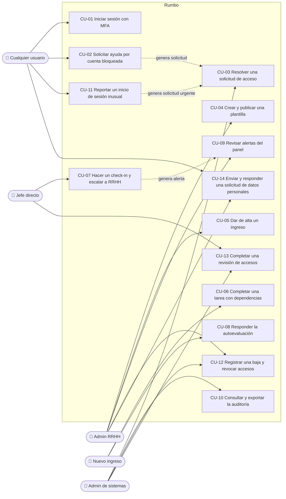

# Casos de uso

Formato por caso: actor principal, actores secundarios, precondiciones, disparador, flujo principal, flujos alternativos y de excepción, postcondiciones y RF relacionados.

## Diagrama general de actores y casos de uso

Muestra los cinco actores (cualquier usuario agrupa a los cuatro roles cuando el caso es común) y los 14 casos de uso. Las líneas punteadas indican que un caso dispara otro. CU-01 a CU-10 son de fase A; CU-11 a CU-14, de fase B.

---

## CU-01 · Iniciar sesión con MFA

| Campo | Detalle |
| --- | --- |
| Actor principal | Cualquier usuario |
| Actores secundarios | Proveedor de identidad simulado (Microsoft o Google Workspace) |
| Precondiciones | La cuenta existe, no está bloqueada y no hay sesión activa. |
| Disparador | El usuario abre la plataforma o una ruta interna sin sesión. |
| RF relacionados | RF-001 a RF-007, RF-014, RF-020 |

**Flujo principal (SSO)**
1. El sistema muestra G1 con SSO como opción principal, el acceso con correo y los accesos de demo.
2. El usuario elige "Continuar con Microsoft".
3. El sistema muestra G2 simulando la redirección y la elección de cuenta.
4. El usuario elige su cuenta.
5. El sistema muestra G3 y pide el código de 6 dígitos (en la demo, visible en un aviso).
6. El usuario ingresa el código y, si quiere, marca "Recordar este dispositivo por 30 días".
7. El sistema valida el código, crea la sesión, registra `auth.login` y `auth.mfa_verified` y lleva al usuario a la ruta pedida o al inicio de su rol.

**Flujos alternativos**
- **2a. Correo y contraseña:** el usuario elige "Iniciar sesión con correo y contraseña", completa los datos y continúa en el paso 5.
- **2b. Acceso de demo:** el usuario elige una tarjeta "Entrar como...". El sistema recorre los pasos 3 a 7 con el código precargado; el usuario solo confirma.
- **5a. Dispositivo recordado:** si el dispositivo fue recordado hace menos de 30 días, el sistema omite G3.
- **6a. Código de respaldo:** el usuario elige "Usar un código de respaldo" y lo ingresa.

**Flujos de excepción**
- **2a.1. Credenciales inválidas:** el sistema muestra "Correo o contraseña incorrectos", suma un intento fallido y registra `auth.login_failed`.
- **2a.2. Quinto intento fallido:** el sistema bloquea la cuenta, registra `auth.account_locked` y muestra un aviso sin culpar que deriva a "¿Problemas para iniciar sesión?" (CU-02).
- **6b. Código inválido:** "No pudimos verificar el código. Revisa que tenga 6 dígitos." Se registra `auth.mfa_failed`.
- **7a. Contraseña restablecida por sistemas:** antes de entrar, el sistema pide una contraseña nueva con la política visible y validada en vivo.

**Postcondiciones**
Hay una sesión activa con vencimiento por inactividad de 15 minutos y el evento de inicio está en la auditoría.

---

## CU-02 · Solicitar ayuda por cuenta bloqueada

| Campo | Detalle |
| --- | --- |
| Actor principal | Cualquier usuario sin sesión |
| Actores secundarios | Admin de sistemas (recibe la solicitud) |
| Precondiciones | El usuario no puede iniciar sesión (cuenta bloqueada, contraseña olvidada o problema con el código). |
| Disparador | El usuario elige "¿Problemas para iniciar sesión?" en G1 o en el aviso de bloqueo. |
| RF relacionados | RF-005, RF-008, RF-009, RF-010 |

**Flujo principal**
1. El sistema muestra G4: explica que las cuentas son corporativas, aclara qué contraseña usar si entra con SSO y muestra los canales de la mesa de ayuda con su horario.
2. El usuario completa el formulario "Solicitar ayuda a sistemas": correo corporativo, motivo "Cuenta bloqueada" y comentario opcional.
3. El sistema valida los campos.
4. El sistema crea la solicitud con número (por ejemplo, `IT-2026-0142`), registra `access_request.create` y muestra la confirmación: sistemas va a verificar la identidad antes de restablecer el acceso.
5. En la demo, la confirmación ofrece "Ver como sistemas (demo)", que continúa en CU-03.

**Flujos alternativos**
- **2a. Otro motivo:** "Olvidé mi contraseña", "No recibo el código de verificación" u "Otro"; el flujo es el mismo.

**Flujos de excepción**
- **3a. Correo con formato inválido o motivo vacío:** el error aparece junto al campo y el foco va al primer error.
- **4a. El correo no existe:** el sistema muestra exactamente la misma confirmación, para no revelar qué cuentas existen.

**Postcondiciones**
La solicitud está en la bandeja de sistemas con estado "nueva". El usuario sigue sin poder entrar hasta que se resuelva.

---

## CU-03 · Resolver una solicitud de acceso

| Campo | Detalle |
| --- | --- |
| Actor principal | Admin de sistemas |
| Actores secundarios | Jefe directo del solicitante (para la verificación), solicitante |
| Precondiciones | Sesión de sistemas activa; existe una solicitud "nueva" o "en verificación". |
| Disparador | Diego abre la solicitud desde S1 o desde el enlace de demo. |
| RF relacionados | RF-052 a RF-055, RF-060 |

**Flujo principal**
1. El sistema muestra S2 con los datos de la solicitud y el checklist de verificación de identidad.
2. Diego marca la verificación ("Llamada al interno registrado" o "Validación con el jefe directo"). La solicitud pasa a "en verificación".
3. El sistema habilita las acciones de resolución.
4. Diego elige "Desbloquear cuenta" y agrega una nota opcional.
5. El sistema pide confirmación, aplica la acción, cambia el estado a "resuelta" y registra `access_request.resolve` y `account.unlock`.
6. El solicitante puede volver a iniciar sesión (CU-01).

**Flujos alternativos**
- **4a. Forzar cambio de contraseña:** al iniciar sesión, el usuario debe crear una contraseña nueva (CU-01, 7a).
- **4b. Restablecer verificación en dos pasos:** el usuario vuelve a configurar MFA al iniciar sesión.
- **4c. Rechazar:** Diego indica el motivo (obligatorio); la solicitud pasa a "rechazada".

**Flujos de excepción**
- **3a. Sin verificación de identidad:** las acciones siguen deshabilitadas con el motivo "Primero verifica la identidad".
- **2a. No se puede verificar la identidad:** Diego rechaza la solicitud con ese motivo.

**Postcondiciones**
La solicitud queda cerrada con acción, autor y fecha, y todo queda en la auditoría.

---

## CU-04 · Crear y publicar una plantilla

| Campo | Detalle |
| --- | --- |
| Actor principal | Admin RRHH |
| Actores secundarios | Ninguno |
| Precondiciones | Sesión de RRHH activa. |
| Disparador | Carla elige "Crear plantilla" en A5. |
| RF relacionados | RF-029 a RF-035; fase B: RF-064 a RF-068 |

**Flujo principal**
1. Carla completa nombre, puesto y área de la plantilla.
2. El sistema abre A6 con las cuatro etapas fijas vacías.
3. Carla agrega una tarea: título, descripción, tipo, responsable, plazo relativo y dependencias.
4. El sistema valida la tarea y la ubica en su etapa.
5. Carla repite los pasos 3 y 4 y reordena tareas arrastrando o con teclado.
6. Carla abre la vista previa (A7) con una fecha de ingreso de ejemplo y revisa las fechas.
7. Carla guarda la plantilla. El sistema muestra "Plantilla guardada" y registra `template.create`.

**Flujo alternativo (fase B: publicación)**
- **7a.** Carla elige "Publicar". El sistema muestra el resumen de cambios y pide una nota de versión. Al confirmar, la plantilla queda como v1 publicada y se puede asignar.
- **1a. Duplicar:** Carla duplica una plantilla existente y la edita.

**Flujos de excepción**
- **4a. Dependencia circular:** "Esta dependencia crea un ciclo: Tarea A depende de Tarea B, que depende de Tarea A." No se guarda.
- **4b. Dependencia con plazo posterior:** el error indica las dos tareas y sus plazos.
- **4c. Plazo fuera del rango de la etapa:** el sistema muestra una advertencia, no un error (decisión D-05).

**Postcondiciones**
La plantilla está disponible en A5 y se puede asignar en el alta de ingresos (en fase B, solo si está publicada).

---

## CU-05 · Dar de alta un ingreso

| Campo | Detalle |
| --- | --- |
| Actor principal | Admin RRHH |
| Actores secundarios | Jefe directo y buddy (asignados), sistemas (fase B: tareas de accesos) |
| Precondiciones | Existe al menos una plantilla disponible. |
| Disparador | Carla elige "Dar de alta un ingreso" en A2. |
| RF relacionados | RF-036 a RF-040; fase B: RF-078 |

**Flujo principal**
1. Carla completa nombre, puesto, área, fecha de ingreso, jefe directo, buddy y plantilla.
2. El sistema valida los datos.
3. El sistema genera el recorrido: copia las tareas de la plantilla y calcula `dueDate = startDate + offsetDays`.
4. El sistema crea los check-ins de 30, 60 y 90 días, registra `hire.create` y muestra "Ingreso creado".
5. El sistema abre la ficha del ingreso (A4).

**Flujos alternativos**
- **1a. Puesto con plantilla sugerida (fase B):** el sistema preselecciona la plantilla.
- **4a. Fase B:** se generan las tareas de accesos para sistemas según el puesto.

**Flujos de excepción**
- **2a. Campos obligatorios vacíos o fecha inválida:** error junto a cada campo.
- **2b. Jefe y buddy son la misma persona:** el sistema lo indica y pide elegir otra persona como buddy.

**Postcondiciones**
El ingreso aparece en A2, en J1 del jefe asignado y, si la fecha ya llegó, en el panel como activo.

---

## CU-06 · Completar una tarea con dependencias

| Campo | Detalle |
| --- | --- |
| Actor principal | Nuevo ingreso |
| Actores secundarios | Jefe y RRHH (ven el avance) |
| Precondiciones | Sesión de Sofía activa; existe una tarea pendiente propia de la que depende otra. |
| Disparador | Sofía ve la tarea en "Lo próximo" o en su etapa (N1). |
| RF relacionados | RF-021 a RF-027 |

**Flujo principal**
1. Sofía abre la tarea "Configurar el entorno de análisis" (N2).
2. El sistema muestra descripción, responsable, fecha límite y recurso.
3. Sofía elige "Marcar como hecha".
4. El sistema marca la tarea como hecha, dibuja el check y actualiza el progreso general y de la etapa.
5. El sistema recalcula las dependencias: "Primer análisis guiado" deja de estar bloqueada y se resalta brevemente.
6. El sistema muestra "Tarea completada" y actualiza "Lo próximo".

**Flujos alternativos**
- **1a. Curso:** Sofía elige "Abrir curso", recorre el contenido simulado y vuelve para marcarlo como completado.

**Flujos de excepción**
- **3a. Tarea bloqueada:** el botón está deshabilitado y el sistema explica "Primero completa: Acceso a Jira".
- **3b. Tarea de otro responsable:** Sofía no puede marcarla; ve quién es el responsable.

**Postcondiciones**
El avance se refleja en J1, J2, A4 y en los KPIs del panel.

---

## CU-07 · Hacer un check-in y escalar a RRHH

| Campo | Detalle |
| --- | --- |
| Actor principal | Jefe directo |
| Actores secundarios | Nuevo ingreso (autoevaluación previa), RRHH (recibe la alerta) |
| Precondiciones | El ingreso pertenece al equipo de Martín y tiene un check-in pendiente. |
| Disparador | Martín elige "Hacer check-in" en J1 o J2. |
| RF relacionados | RF-046 a RF-051, RF-044 |

**Flujo principal**
1. El sistema muestra J3 con la autoevaluación del ingreso (si ya la respondió) y los hitos de la etapa.
2. Martín evalúa cada hito como cumplido, parcial o no cumplido.
3. Un hito queda como "no cumplido". El sistema pide elegir una acción.
4. Martín elige "Escalar a RRHH" y escribe una nota.
5. Martín completa comentarios y próximos pasos y elige "Enviar check-in".
6. El sistema guarda el check-in como completado, registra `checkin.complete` y `checkin.escalate` y genera una alerta en el panel de RRHH.

**Flujos alternativos**
- **3a. Todos los hitos cumplidos o parciales:** no se pide acción; continúa en el paso 5.
- **4a. Reprogramar:** Martín elige una nueva fecha posterior a hoy; el check-in queda reprogramado sin alerta.
- **1a. Sin autoevaluación:** el sistema avisa que la persona todavía no respondió, sin impedir el check-in.

**Flujos de excepción**
- **5a. Hitos sin evaluar o nota de escalamiento vacía:** el error aparece junto al campo correspondiente.

**Postcondiciones**
El check-in queda en el historial (A4, J2) y, si se escaló, la alerta aparece en A1 con enlace a la ficha.

---

## CU-08 · Responder la autoevaluación

| Campo | Detalle |
| --- | --- |
| Actor principal | Nuevo ingreso |
| Actores secundarios | Jefe directo y RRHH (la leen) |
| Precondiciones | Hay un check-in pendiente para Sofía. |
| Disparador | Sofía elige "Responder mi check-in" en N1. |
| RF relacionados | RF-050 |

**Flujo principal**
1. El sistema muestra N3 explicando quién va a leer la respuesta (su jefe y RRHH).
2. Sofía elige cómo se siente (escala de 1 a 5 con etiquetas de texto) y escribe un comentario.
3. Sofía elige "Enviar autoevaluación".
4. El sistema guarda la respuesta, cambia el check-in a "hire_done" y muestra "Autoevaluación enviada".

**Flujos de excepción**
- **3a. Sin elegir cómo se siente:** error junto al campo.

**Postcondiciones**
Martín ve la autoevaluación en J2 y J3.

---

## CU-09 · Revisar alertas del panel

| Campo | Detalle |
| --- | --- |
| Actor principal | Admin RRHH |
| Actores secundarios | Ninguno |
| Precondiciones | Sesión de RRHH activa. |
| Disparador | Carla entra al panel (A1). |
| RF relacionados | RF-041 a RF-045 |

**Flujo principal**
1. El sistema muestra el panel en grilla bento: KPIs, gráfico de avance, tareas atrasadas por responsable y alertas.
2. Carla identifica en el gráfico que IT concentra la mayoría de los atrasos.
3. Carla abre la alerta "Check-in escalado".
4. El sistema abre la ficha del ingreso (A4) en el check-in correspondiente.
5. Carla marca como hecha una tarea de IT que ya se resolvió fuera de la plataforma.
6. Al volver al panel, los KPIs reflejan el cambio.

**Flujos alternativos**
- **1a. Sin alertas:** el bloque explica que no hay recorridos en riesgo.

**Postcondiciones**
Los cambios se reflejan en todas las vistas.

---

## CU-10 · Consultar y exportar la auditoría

| Campo | Detalle |
| --- | --- |
| Actor principal | Admin de sistemas |
| Actores secundarios | Ninguno |
| Precondiciones | Sesión de sistemas activa. |
| Disparador | Diego necesita revisar un acceso denegado. |
| RF relacionados | RF-057, RF-060 |

**Flujo principal**
1. Diego abre la pestaña "Auditoría" de S3.
2. Filtra por tipo de evento "Acceso denegado" y por rango de fechas.
3. El sistema muestra los eventos coincidentes con fecha y hora, usuario, acción, recurso y resultado.
4. Diego elige "Exportar CSV".
5. El sistema genera el archivo con los eventos filtrados y registra `audit.export`.

**Flujos de excepción**
- **3a. Sin resultados:** el sistema explica que no hay eventos con esos filtros y ofrece limpiarlos.

**Postcondiciones**
El CSV queda descargado y la exportación, en la auditoría.

---

## CU-11 · Reportar un inicio de sesión inusual (fase B)

| Campo | Detalle |
| --- | --- |
| Actor principal | Cualquier usuario (Sofía en los datos semilla) |
| Actores secundarios | Admin de sistemas |
| Precondiciones | Existe una alerta de inicio inusual pendiente. |
| Disparador | Sofía recibe la notificación "¿Fuiste tú?". |
| RF relacionados | RF-076, RF-077 |

**Flujo principal**
1. El sistema muestra el dispositivo, el navegador, la ubicación aproximada y la hora del inicio de sesión.
2. Sofía elige "No fui yo".
3. El sistema cierra esa sesión, crea una solicitud urgente para sistemas y registra los eventos.
4. El sistema le indica a Sofía que se comunique con la mesa de ayuda y muestra los canales.

**Flujos alternativos**
- **2a. "Sí, fui yo":** la alerta queda confirmada y se cierra.

**Postcondiciones**
La solicitud urgente aparece primera en S1.

---

## CU-12 · Registrar una baja y revocar accesos (fase B)

| Campo | Detalle |
| --- | --- |
| Actor principal | Admin RRHH |
| Actores secundarios | Admin de sistemas, jefe directo (recordatorio) |
| Precondiciones | La persona está activa. |
| Disparador | Carla registra una desvinculación en A11. |
| RF relacionados | RF-078 |

**Flujo principal**
1. Carla elige la persona, el tipo de baja y la fecha efectiva.
2. El sistema crea el evento de baja con el checklist de revocación (cuenta, correo, herramientas, dispositivos) y notifica a sistemas y al jefe.
3. Diego abre la baja en S4 y marca cada acceso como revocado.
4. Al llegar la fecha efectiva, el sistema deshabilita la cuenta y cierra sus sesiones.

**Flujos de excepción**
- **4a. Accesos sin revocar a la fecha efectiva:** el evento queda marcado como atrasado y se notifica a sistemas.

**Postcondiciones**
La persona queda "dada de baja"; cada paso está en la auditoría.

---

## CU-13 · Completar una revisión de accesos (fase B)

| Campo | Detalle |
| --- | --- |
| Actor principal | Jefe directo |
| Actores secundarios | Admin de sistemas |
| Precondiciones | Hay una campaña abierta que incluye al equipo de Martín. |
| Disparador | Martín recibe la notificación de la campaña y abre J4. |
| RF relacionados | RF-079 |

**Flujo principal**
1. El sistema muestra a cada persona del equipo con sus accesos y roles.
2. Martín marca "Mantener" o "Revocar" en cada acceso; revocar pide un motivo.
3. Martín envía la revisión.
4. Diego ve el avance en S6, ejecuta las revocaciones y cierra la campaña.
5. El sistema genera el resumen descargable.

**Postcondiciones**
La campaña queda cerrada con resumen y las revocaciones, en la auditoría.

---

## CU-14 · Enviar y responder una solicitud de datos personales (fase B)

| Campo | Detalle |
| --- | --- |
| Actor principal | Cualquier usuario |
| Actores secundarios | Admin RRHH |
| Precondiciones | Sesión activa y aviso de privacidad aceptado. |
| Disparador | El usuario elige "Enviar una solicitud" en "Mi privacidad" (G10). |
| RF relacionados | RF-071, RF-072 |

**Flujo principal**
1. El usuario elige el tipo (acceso, rectificación o supresión) y describe el pedido.
2. El sistema crea la solicitud con plazo de respuesta visible y notifica a RRHH.
3. Carla la abre en A12, la pasa a "en curso" y redacta la respuesta.
4. El sistema marca la solicitud como respondida y notifica al usuario.

**Flujos alternativos**
- **3a. Rechazo:** Carla rechaza con motivo obligatorio.

**Postcondiciones**
La solicitud queda con estado, responsable y respuesta, visible para el usuario en G10.
